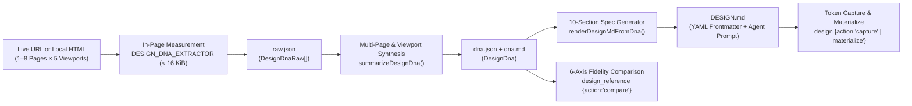

# Design DNA & DESIGN.md Synthesis Engine

WrongStack includes a browser-backed **Design DNA & `DESIGN.md` Synthesis Engine** (`@wrongstack/core/design` + `design_reference` + `/design`) that measures live web applications or local HTML surfaces across a 5-breakpoint responsive matrix and multi-page crawls, producing deterministic design tokens, per-axis fidelity scores, and a complete 10-section **`DESIGN.md`** specification (compatible with both Google Labs `design.md` alpha and `designmd.me` agent prompt specifications).

Related guides:
- [`/design` slash command reference](slash/design.md)
- [Design quality & turn-gate audit](design-quality-workflow.md)
- [Tool reference (`design` & `design_reference`)](tool-reference.md)

---

## 1. End-to-End Architecture

Instead of relying on subjective LLM descriptions of screenshots, WrongStack separates **in-browser measurement** from **Node-side synthesis** and **token/prompt generation**:



### Core Implementation Modules

| Module | Responsibility |
|---|---|
| [`packages/core/src/execution/design-dna-extractor.ts`](../packages/core/src/execution/design-dna-extractor.ts) | Self-contained `< 16 KiB` ES2020 script evaluated in Chromium per viewport. Composites visible pixel colors via `elementsFromPoint`, measures typography runs, spacing, radii, shadows, full CSS gradients, 14+ component archetypes, `:hover`/`:focus`/`:active`/`:focus-visible` CSS rules, `:root` custom properties, and same-origin subpage links. |
| [`packages/core/src/execution/design-dna.ts`](../packages/core/src/execution/design-dna.ts) | Merges multi-page measurements per viewport (`mergeRawsByViewport`), infers semantic + decorative color palettes (`inferRichPalette`), maps 16+ typographic roles (`inferTypographyRoles`), builds token-referenced component catalogs (`inferComponentCatalog`), and synthesizes the 5-breakpoint responsive matrix (`inferBreakpoints`). |
| [`packages/core/src/execution/design-md.ts`](../packages/core/src/execution/design-md.ts) | Parses, validates, converts, and renders `DESIGN.md` documents (`parseDesignMd`, `validateDesignMd`, `designMdToTokens`, `renderDesignMd`, `renderDesignMdFromDna`). Supports both classic WrongStack `DESIGN.md` and the 10-section `designmd.me` format. |
| [`packages/core/src/execution/design-md-diff.ts`](../packages/core/src/execution/design-md-diff.ts) | Semantic diff engine (`diffDesignMd`) reporting WCAG AA contrast regressions (`FAIL`), broken `{colors.*}`/`{rounded.*}`/`{typography.*}` references (`FAIL`), removed tokens (`WARN`), and OKLab ΔE shifts. |
| [`packages/core/src/execution/design-dna-compare.ts`](../packages/core/src/execution/design-dna-compare.ts) | Scores an implementation against a reference `DesignDna` across 6 axes (`color`, `type`, `space`, `shape`, `layout`, `motion`); overall score equals the **lowest** axis. |
| [`packages/tools/src/design-reference.ts`](../packages/tools/src/design-reference.ts) | Browser-session orchestrator (`extract`, `compare`, `inspect`) under WrongStack's network guard and ephemeral loopback file server. |

---

## 2. How to Trigger the Engine

### A. CLI & TUI Slash Commands (`/design`)

Inside any WrongStack CLI or TUI session:

```text
# Extract a live site across 5 breakpoints [1440, 1280, 1024, 768, 375] and up to 6 pages
/design extract https://stripe.com 6

# Extract a single page or local static HTML file (auto-served on loopback)
/design extract https://linear.app
/design extract site/landing.html

# Compare your implementation against an extracted reference slug
/design compare stripe-com http://localhost:5173/
/design compare stripe-com index.html

# Run reference-free rendered defect inspection (overflow, WCAG contrast, target sizes)
/design inspect index.html

# Capture extracted DESIGN.md tokens as the active project token source
/design capture .design/references/stripe-com/DESIGN.md

# Export the active kit or captured tokens to root DESIGN.md
/design document
```

> **Localhost note:** Extracting or comparing a local dev server (`http://localhost:5173`) requires `/browser allow http://localhost:5173` once per session. Passing a project-relative `.html` file (`file` / `/design extract index.html`) needs no dev server or manual allowlist.

### B. Agent Tool Calls (`design_reference` & `design`)

Agents invoke `design_reference` directly when `net.outbound` and browser capabilities are enabled:

```json
{
  "action": "extract",
  "url": "https://stripe.com",
  "maxPages": 6,
  "viewports": [1440, 1280, 1024, 768, 375]
}
```

Optional extraction fields:
- `url` *(string)* — Public or allowed `http(s)` URL. Mutually exclusive with `file`.
- `file` *(string)* — Project-relative `.html` file served on an ephemeral `127.0.0.1` port for the call.
- `name` *(string)* — Custom slug under `.design/references/<name>/` (defaults to URL hostname/path slug, e.g. `stripe-com`).
- `viewports` *(number[])* — 1–6 viewport widths in pixels (defaults to `[1440, 1280, 1024, 768, 375]`).
- `maxPages` *(integer, 1–8)* — Total pages to measure. When `> 1`, auto-discovers same-origin links on the entry page and merges their measurements into the widest viewport.
- `pages` *(string[], 1–7)* — Explicit subpage URLs (e.g. `["https://stripe.com/pricing", "https://stripe.com/docs"]`) to measure and merge.

### C. Standalone Terminal CLI (`bun run design:md`)

Run extraction, fidelity comparison, rendered inspection, schema linting, regression diffs, or native stack materialization directly from a terminal (via [`scripts/design-md.mts`](../scripts/design-md.mts)):

```bash
# 1. Extract DESIGN.md + DNA from a live site (up to 6 pages) and copy DESIGN.md to repo root
bun run design:md extract https://stripe.com --pages 6 --out DESIGN.md

# 2. Lint any DESIGN.md (YAML schema, {colors.*}/{typography.*}/{rounded.*} refs, WCAG AA contrast)
bun run design:md lint .design/references/stripe-com/DESIGN.md

# 3. Diff two DESIGN.md versions and fail CI on contrast or broken-ref regressions
bun run design:md diff DESIGN.v1.md DESIGN.v2.md

# 4. Compile DESIGN.md directly into a native theme file (web | react-native | flutter | swiftui | compose)
bun run design:md materialize DESIGN.md --stack web --out src/styles/tokens.css

# 5. Compare an implementation or inspect a rendered page
bun run design:md compare stripe-com index.html
bun run design:md inspect index.html --surface page
```

### D. Programmatic TypeScript API (`@wrongstack/core/design`)

```ts
import {
  DESIGN_DNA_EXTRACTOR,
  summarizeDesignDna,
  renderDesignMdFromDna,
  parseDesignMd,
  designMdToTokens,
  type DesignDnaRaw,
} from '@wrongstack/core/design';

// 1. Evaluate DESIGN_DNA_EXTRACTOR inside Playwright/Chromium at one or more viewports
const raw = (await page.evaluate(DESIGN_DNA_EXTRACTOR)) as DesignDnaRaw;

// 2. Summarize single- or multi-page/multi-viewport measurements
const dna = summarizeDesignDna([raw]);

// 3. Render the complete YAML frontmatter + 10-section DESIGN.md prompt
const markdown = renderDesignMdFromDna(dna);

// 4. Parse & validate DESIGN.md and convert into light/dark Design Studio tokens
const parsed = parseDesignMd(markdown);
if (parsed.doc && parsed.issues.every((i) => i.severity !== 'error')) {
  const tokens = designMdToTokens(parsed.doc);
}
```

---

## 3. Generated Artifacts (`.design/references/<slug>/`)

Every `extract` run writes a self-contained bundle under `.design/references/<slug>/` (gitignored automatically via `.design/.gitignore`):

| Artifact | Contents |
|---|---|
| `DESIGN.md` | Normative YAML frontmatter + 10-section Agent Prompt specification (`designmd.me` & Google `design.md` compatible). |
| `dna.json` | Structured `DesignDna` JSON (measured vs. inferred roles, scales, component catalog, breakpoints, coverage). |
| `dna.md` | Compact human/model summary separating measured counts from inferred roles and listing measurement caveats. |
| `raw.json` | Raw `DesignDnaRaw[]` browser payloads across every measured viewport and subpage. |
| `1440.png` … `375.png` | First-screen viewport screenshots for visual verification of imagery, crop, and tone alongside the numbers. |
| `fidelity.md` | Written by `compare`: per-axis fidelity table (`color`, `type`, `space`, `shape`, `layout`, `motion`) and out-of-tolerance properties. |

---

## 4. `DESIGN.md` Specification Structure

### YAML Frontmatter Schema

| Key | Description |
|---|---|
| `version` | Schema version (`alpha`). |
| `name` & `description` | Clean brand/system name and synthesized visual atmosphere summary. |
| `source` | `{ url, pagesAnalyzed, extractedAt, tokensMeasured }`. |
| `colors` | Semantic roles (`primary`, `accent`, `link`, `canvas`, `surface`, `ink`, `body`, `muted`, `faint`, optional `border`) plus decorative/gradient ramps (`accent-1..5`, `neutral-1..2`). |
| `typography` | Role map (`display-lg`, `display-md`, `heading-xl..xs`, `body-lg..sm`, `body-sm-strong`, `nav`, `button-lg..xs`, `label`, `caption-md..xs`) with `{ fontFamily, fontSize, fontWeight, lineHeight, letterSpacing, textTransform }`. |
| `rounded` | Monotonic corner-radius scale (`none`, `xs`, `sm`, `md`, `lg`, `xl`, `full`). |
| `spacing` | Inferred base-unit rhythm (`xxs`, `xs`, `sm`, `md`, `lg`, `xl`, `xxl`, `xxxl`, `section`, `band`). |
| `borderWidths` & `shadows` | Hairline border width (`thin`) and blur-sorted shadow scale (`sm`, `md`, `lg`, `xl`) + `elevationStrategy` (`progressive` or `border+surface`). |
| `themes` | `{ derived: "dark" \| "light", light: {...}, dark: {...} }` — combines the directly measured theme with a perceptually derived counterpart. |
| `gradients` | Deduplicated CSS gradient expressions with `{ context: "hero" \| "section" \| "surface", kind: "radial" \| "linear" \| "conic", value }`. |
| `components` | Up to 14 measured component archetypes (`button-primary`, `button-primary-sm`, `button-filled`, `button-outline`, `button-icon`, `card`, `card-lg`, `navigation`, `navigation-sm`, `footer`, `link`, `link-sm`, `badge-text`, `badge-filled`) using `{colors.*}`, `{rounded.*}`, and `{typography.*}` token references. |
| `states` | Extracted CSS interaction rules (`button-hover`, `button-focus`, `nav-hover`, `nav-focus`, `link-hover`, `link-focus-visible`, etc.). |
| `breakpoints` | 5-viewport responsive matrix (`width`, `containerWidth`, `gridColumns`, `navLinksVisible`, `menuToggleVisible`, `headingPx`, `bodyPx`, `sectionPaddingX`). |
| `coverage` | Extraction telemetry (`statesFound`, `gradientsFound`, `rolesUnassigned`, `archetypesUnnamed`, `archetypesDetected`, `responsiveMeasured`, `stylesheetsBlocked`, `semanticRampDeclared`). |

### 10-Section Agent Prompt Body

1. **Visual Theme & Atmosphere** — Prose overview, key characteristics, and detected structural signals.
2. **Color Palette & Roles** — Primary, Accent, Neutral Scale, Decorative & Utility, and Semantic/Status notes.
3. **Typography Rules** — Font families, full Markdown hierarchy table, modular scale ratio, tracking, and weight principles.
4. **Component Stylings** — Normative property blocks for every detected component archetype.
5. **Layout Principles** — Spacing system fit, grid & max container width, whitespace philosophy, border-radius scale, and border widths.
6. **Depth & Elevation** — Elevation table (`Flat` → `Subtle XL` → `Medium LG` → `Elevated MD` → `Strong SM`) and shadow philosophy.
7. **Do's and Don'ts** — Guardrails grounded in measured chromatic share, radii, contrast pairs, and responsive scaling.
8. **Responsive Behavior** — 5-breakpoint Markdown matrix, effective mobile/tablet/desktop rules, touch targets, and collapsing strategy.
9. **Agent Prompt Guide** — Quick color reference + 10-rule actionable iteration checklist for code-generating agents.
10. **Known Gaps** — Honest caveats (CORS-blocked external stylesheets, missing status ramps, perceptually derived secondary theme, unvisited authenticated flows, screen-sampling bounds).

---

## 5. Validation, Linting & Token Diffing

`parseDesignMd` and `validateDesignMd` enforce structural and accessibility invariants on both hand-edited and generated `DESIGN.md` files:

- **`duplicate-key` / `duplicate-section` (`error`)** — YAML map keys and Markdown H2 headings must be unique ( checked before YAML parsing so duplicate keys are never silently overwritten).
- **`broken-ref` (`error`)** — Every `{colors.<k>}`, `{rounded.<k>}`, `{spacing.<k>}`, and `{typography.<k>}` reference inside `components` must resolve to a defined token.
- **`contrast` (`warning` on parse / `FAIL` on regression in `diffDesignMd`)** — Checks WCAG AA (`4.5:1`) contrast across light and dark text/surface pairs (`ink`/`canvas`, `fg`/`bg`, `on-*`/`*`, and component `textColor`/`backgroundColor`).
- **`section-order` (`warning`)** — Accepts either the classic 6-section WrongStack order (`Overview` → `Colors` → `Typography` → `Elevation` → `Components` → `Do's and Don'ts`) or the numbered 10-section `designmd.me` order.
