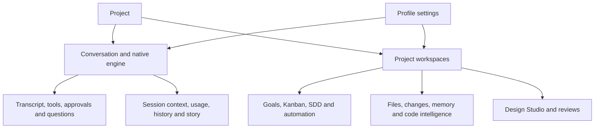

# Desktop v2 product and WebUI parity review

Reviewed: **2026-11-10**. Source baseline: `a6211d4792ceb1758bb9f8116fa0dd8958b8e74f`, shared `main`, including the pre-existing working changes. Both frontend manifests and the Tauri configuration identify **1.5.6**. The baseline investigation preceded the implementation checkpoint below.

Desktop v2 already contains the major product workspaces. The remaining problem is the consistency of complete workflows: how users reach a capability, retain their place, understand its scope, recover from failure, and inspect its result. Adding more screens should follow closure of these workflow gaps.

The highest priorities are renderer fault containment, correct design-source classification, and acceptance of one identified native package. Navigation inventory is substantially covered, while action, lifecycle, visual and packaged-runtime parity remain separate questions.

## Current action matrix

The implementation checkpoints preserve their own receipts below, including each artifact and harness identity. This table tracks what they permit us to conclude now; it does not transfer a browser result to an untested native scenario.

| Findings | Current evidence | Remaining acceptance or decision |
| --- | --- | --- |
| R01, R02, R08 | Implemented; permanent regressions and browser failure/input/localization controls passed | Packaged renderer-failure recovery and localized shared-dialog controls |
| R04, R05 | Shared reference form and result actions implemented; native prepared-draft ownership, real extraction progress and artifact navigation passed on pair `d11e404d121f-759d13e29a40` | Native validation-pending owner changes and interrupted extraction were not exercised; reload check waits for host layout acknowledgement |
| R09 | Native inspect/compare handoff displayed the actual measured results and opened the correct reports in conversation and Run activity | Project-level state when no review exists; older cards still link to report paths reused by later runs |
| R06 | Desktop retains grouped UI/code controls; fallback, terminal, Monaco and 800×600 native zoom were exercised | Independent WebUI font roles/presets remain an explicit product difference |
| R07 | Native Files/Run returns, disclosure/draft/focus and following-mode controls passed at 1280×840 and 800×600 on pair `f2f66f2c7c0a-759d13e29a40`; twelve paused-return measurements had 0 CSS px drift. Round 21 adds three native passes for pending-question arrival and retained conversation review on the same pair | R20 closes growing-reply reading; renderer-reload, cross-session and whole-app restart restoration remain separate |
| R03 | Guarded Windows payload identified; dated Files, Design, display-preference, Composer and corrected-performance receipts passed on that payload | Complete native matrix with the current harness, other operating systems and physical microphone acceptance |
| R10 | Shared contracts and narrow fixes retained; large component owners remain maintenance observations | Extract only when a measured defect or workflow change requires it |
| R11 | This current matrix separates implementation, package acceptance and historical findings; the older ledger links here and identifies itself as historical | Keep dated receipts and explicit remaining acceptance as work continues |
| R12 | Current installer size, startup, service memory and terminal/tree/transcript workloads measured | Size/startup/terminal targets remain unmet in the measured run; define a matched blank-idle workload for the RAM target |
| R13 | False-success guard implemented; isolated-controller standalone replacement passed three times and through the permanent command. Renamed-product removal still needed one retry | First-attempt removal reliability, broader shutdown cases and remaining release/platform acceptance stay open |
| R14, R15 | Failure reason no longer depends on the caller's saved register; both reasons use the seven-language NSIS catalog. Source-bound native message checks passed 31 cases on three runs | Actual Abort arguments and caller state are covered; visual installer layout and a deliberately persistent mapped-image refusal were not exercised |
| R16 | Standalone installer's native fixture now uses explicit process creation flags and verifies separation from the controller console; original failure reproduced, three passing verifications and permanent command | The full installer fixture already isolates its console; its first-attempt uninstall failure has a separate, unresolved cause |
| R17 | Native nested-package artifact failure reproduced with a passing root-session control; design cards now use the validated engine-reported root. The rebuilt UI and unchanged accepted engine passed the complete handoff scope | UI-only local package; the last full backend attempt failed plugin-panel declarations and was not rerun in R18. Other native scopes retain their dated pair/harness receipts |
| R18 | Main-window immediate reload selection loss fixed; old package failed the gated native assertion, and new pair `7ceef93287ab-759d13e29a40` passed with the same harness. Three repeated focused runs, full Desktop suite and types passed | Closing the whole app before the host save, project-window selection recovery and broader host-write ordering remain separate boundaries |
| R19 | Find with an expanded activity could hide the message above a short pane. Start alignment fixed it; real-Virtualizer RED/control/GREEN, three durable browser passes and same-harness native before/after receipts | Other native scenarios retain their dated pair/harness receipts; the separate growing-message defect is addressed in R20 |
| R20 | Automatic following could outlive a wheel pause and replay its end target. The original failing browser proof now passes; the same native harness fails the old UI and passes the new UI at both viewport sizes, with 0 px drift during message growth | Native stream acceptance deliberately holds measurement timeouts; ordinary browser timing also passed. Round 21 adds native question arrival/review/submission acceptance; reload/restart/cross-session recovery remains separate |

## Current implementation checkpoint

The first reliability batch implements **R01, R02 and R08**. The design workflow checkpoint below records the subsequent changes. Detailed findings preserve the original review baseline.

| Finding | Implemented behavior | Verification |
| --- | --- | --- |
| R01 | A workspace error retains the shell/navigation and offers Mission Control or an explicit window reload. Navigation resets the failed workspace boundary. A separate root boundary offers reload when the shell itself cannot render. Recovery text ships in all seven languages; reload warns about unsaved changes | Permanent App regression; six real Chromium cases cover module rejection, view render error and root error in EN/dark/1480×960 and TR/light/800×600, including navigation and reload recovery |
| R02 | Explicit HTTP(S) sources take precedence over HTML suffixes; local HTML suffix detection is case-insensitive | Eleven permanent source/workflow cases; original browser assertion now passes with the same HTTPS/local controls |
| R08 | Shared confirmation defaults follow the common translation catalog live; explicit caller labels remain intact | Permanent open-dialog language-switch and explicit-label/acknowledgement tests; original browser assertion now passes |

The three new test files passed **14 tests on three consecutive runs**. The three original audit contracts also passed unchanged against current source. No native executable was rebuilt or exercised for this batch, and no release parity claim follows from these frontend results. Source changes preserve the unrelated existing working changes.

Final package checks: **325 test files / 1,175 tests passed**, production types passed over **767 files**, and the frontend production build passed. Scoped Biome checks and `git diff --check` passed. The build retains its large-chunk advisory, and Biome reports the repository's existing schema/CLI version advisory; neither configuration was changed by this batch.

The durable browser check is `bun run --filter @wrongstack/desktop-v2 test:render-recovery`. Evidence for this batch is retained under `.temp_files/desktop-v2-reliability-2026-11-10/`; browser receipts and screenshots are under `.temp_files/desktop-render-recovery/`.

## Design workflow checkpoint 2026-11-11

**R04 and R05 are implemented in the Desktop source.** Conversation Tools opens the reference form in an existing conversation. Project Design Studio uses the same form and requires a conversation from that project. The launcher prepares an append to the draft and keeps sending under the user's control. Draft validation checks revision conflicts before saving. The conversation launcher also rejects an append if its draft or owner changes while validation is pending. The welcome screen retains its four-stage overview.

The form offers extraction alone, web theme generation and React Native theme generation. Its instructions use the actual reported `DESIGN.md` path for capture and explain that a pinned kit takes precedence during materialization. The live card reads progress from the journal and presents a file action for a reported project-relative specification after successful extraction. A failed or interrupted tool call has no completed artifact action. File navigation resolves the artifact at the owning project root, including from a nested working directory.

| Check | Observed result |
| --- | --- |
| Desktop test suite | **327 files / 1,193 tests passed** |
| Production typecheck and frontend build | **771 files without type errors**, production frontend build passed |
| Chromium workflow | Existing draft preserved, no `user_message` sent, React Native prompt prepared, journal progress advanced, the actual tool output routed to the correct project path, and Studio excluded foreign and terminal sessions |
| Visual check | English dark conversation and Turkish light Studio at 800×600. The development browser logged one ResizeObserver notification warning during the fixture run |
| Actual tool workflow on a local HTML fixture | Five viewport measurements produced a 10-section `DESIGN.md` that passed document lint. Capture read 90 token values. Web and React Native materialization wrote theme files. Rendered inspection reported 0 FAIL and 0 WARN. Comparing the fixture against its own reference matched 26/26 measured properties |

The Chromium scenario uses controlled engine responses and checks the route and file target. The extraction, capture, materialization, inspection and comparison commands ran separately against a real fixture. Evidence is under `.temp_files/desktop-design-flow-2026-11-11/`.

## Rendered review checkpoint 2026-11-11

The conversation and Run activity now show rendered inspection findings and fidelity scores for **R09**. The cards display the measured target, reference where applicable, viewport widths, and completion-frame time when present. A failed or interrupted call has no completed report action. A successful call can still report layout or accessibility findings. A clipped result without measurements shows an unavailable state. If the engine reports a write to a known artifact in the owning project, the user can open it from the card.

The shared reference form in Conversation Tools and Project Design Studio now offers rendered inspection and fidelity comparison. Inspection takes an implementation URL or local HTML file and a page or application surface. Comparison also takes an extracted reference name. Both prepare a conversation draft. Studio requires the user to choose an agent conversation in the current project.

| Check | Observed result |
| --- | --- |
| Actual `design_reference` tool on two local HTML pages at 1024 and 375 px | Clean page **0 FAIL / 0 WARN**. Broken page **3 FAIL / 0 WARN**. Comparing the reference to itself yielded **100%**, and comparing the altered page yielded **60%**. The tool wrote each expected Markdown report |
| Chromium with real tool output projected through the production serializer and path normalizer | Five scenarios passed across English dark and Turkish light layouts. Both prompts preserved the draft and sent no message. Conversation and Run activity routed the report to the owning project from a nested working directory. Studio required a same-project conversation |
| Desktop validation | **328 test files / 1,204 tests passed**. Production typecheck covered **773 files**. Frontend build and scoped Biome checks passed |

The browser fixture controls the engine connection and observes the Files route and file target. The current engine reuses report paths on repeat runs, so an older card retains its recorded measurements while its link opens the latest report written to that path. A missing review call still has no project-level review status. Packaged native acceptance remains open. Evidence, including the measured outputs, browser receipts and screenshots, is under `.temp_files/desktop-design-review-2026-11-11/`.

## Conversation reading position checkpoint 2026-11-11

**R07 is implemented for tool visits within a conversation.** Returning from Files or Run activity keeps the same visible message and offset, including an open tool disclosure. The Desktop keeps the virtualized transcript mounted and hidden during the visit. This preserves its measurements and disclosure state while the composer and tool panels retain their existing mount lifecycle. An earlier Find jump runs again only when a new target is selected, so background replies cannot recenter an old search result.

The Chromium regression drives the production conversation workspace, transcript, and engine reducer at 1280×840 and 800×600. The original Files return lost the message and jumped to `scrollTop: 0`. The fixed return stays within 2 CSS px of the recorded message offset. The scenarios also check keyboard return, hidden transcript controls, an unsent draft, incoming text while paused and while following, and a question that arrives during a Files visit.

Run the regression with `bun apps/desktop-v2/tests/transcript-tab-return-browser.mjs`. The fixture supplies the engine connection and the Files content boundary. The result covers in-session tab visits. Cross-session and restart restoration and the packaged Windows executable remain outside this verification. Evidence is under `.temp_files/desktop-reading-position/`.

## Typography and minimum-window zoom checkpoint 2026-11-11

**R06 retains the Desktop’s two font controls and native window zoom.** The interface choice covers the shell, chat reading text and the body of shared panels. The code choice covers inline code, code blocks, Monaco, the diff editor and xterm. The latter surfaces now use the same Cascadia Code → Consolas → monospace default shown in Appearance. A named installed font can fall back to the default stack, as the localized settings now explain. Shared display headings retain their existing display styles.

WebUI still exposes independent display, reading, editor and terminal families, ten presets with bundled or lazy-loaded fonts, and separate editor and terminal sizes and line heights. Desktop groups those choices and uses the machine’s installed font catalog for custom families. Monaco and code blocks use the code ligature setting. xterm uses its own rendering and font measurement.

At a physical client size of 800×600, 150% and 200% zoom yield 533×400 and 400×300 CSS px respectively on the tested Windows configuration. The previous body stayed 620 CSS px wide. The compact rail now opens the project and session explorer on demand, supports Escape and pointer dismissal, and restores keyboard focus on Escape. In a short viewport the focused workbench scrolls vertically so the transcript, input and send action remain reachable.

| Check | Observed result |
| --- | --- |
| Current-source Windows WebView2 development build | Native zoom at 100%, 125%, 150%, 175% and 200% fit the 800×600 client. At 200% the explorer opened and closed, a real terminal rendered PowerShell output and retained a measurable grid, and Ctrl+0 returned to 100% |
| Chromium font and layout checks | Geist rendered chat and shared interface text, including fallback for a missing named font. Code, Monaco, diff and terminal used the advertised default stack. Choosing Consolas updated the active widgets. The compact appearance controls and conversation send action remained reachable |
| Desktop package | 328 files and 1,204 tests passed with six workers. Production typecheck covered 773 files. Frontend build, scoped Biome and `git diff --check` passed |

The Windows test used a hidden development build from this checkout and an isolated profile and PTY. The first native editor attempt stopped before editing because the fixture file did not appear in the project tree. The editor font checks used the production Monaco components in Chromium. The package checkpoint below follows the missing file to its cause. Evidence for the typography round is under `.temp_files/desktop-typography/`.

## Windows package and project scope checkpoint 2026-11-11

The baseline packaged app opened the parent repository when Desktop registered a nested folder without a project marker. A sibling with its own marker opened normally. The project engine's `session.start` reported the parent root, and Files listed a file that only existed in the parent. Desktop now tells project and profile services to boot at the exact directory selected by the host. On the rebuilt package the engine reported the registered folder and Files showed its own TypeScript file. The parent-only file was absent from the tree.

The current Windows x64 NSIS installer was built locally with pinned Bun 1.4.3 and a source fingerprint check across the build. The archive is **52,143,112 bytes (49.73 MiB)**, above the historical 15 MB target. Its SHA-256 is `4b971e215580c5c76c643a5d0c015e0c8e90d32fc95e05dee4d220c1ba446793`. The engine payload matches the guarded build hash. The application payload differs from the portable application in three bytes, which are the Tauri NSIS bundle-type marker. The tested pair came from the installer archive and has identity `3019a97f5008-759d13e29a40`.

On that pair, both project cases opened in Monaco. At a real 800×600 Windows client size, 200% zoom produced a 400×300 CSS viewport. The editor displayed the expected TypeScript with Cascadia Code first in its font stack. The document width matched the available client width and Ctrl+0 restored the normal view. Core path-resolution and boot tests passed 31 cases. WebUI server boot tests passed 12 cases. Typechecks passed for Core, WebUI server and Desktop.

Four selected native scenarios completed on the installer payload. Files covered version-bound saves, index readback, stale edits, conflict variants, a 3,000-file virtual tree, bulk operations and Git history. Display preferences covered two-window synchronization and reload. Design covered draft recovery, project isolation, theme generation and disk readback. Performance exercised the native workload below. The four-scope receipt is `.temp_files/desktop-parity-acceptance/matrix-2026-11-11T01-13-10-743Z/matrix.json`.

The initial performance helper included unrelated processes through reused Windows parent PIDs and read the default portable directory while the run used an explicit package. The helper now checks process creation times before following a parent link and respects the selected package. A permanent regression covers stale PIDs, valid descendants and unknown creation times. The corrected performance rerun passed on the same payload with its own harness identity, recorded in `.temp_files/desktop-parity-acceptance/matrix-2026-11-11T01-26-28-597Z/matrix.json`.

| Corrected Windows workload | Observed result |
| --- | --- |
| Fresh native UI and host launch | Shell rendered in **5.533 s**, host connected in **5.559 s** |
| Reopen UI over the running host | Host connected in **3.178 s**. This measures a UI relaunch |
| Quiescent test profile and project services after setup | **3,318.5 MiB private bytes** across the owned UI, WebView2, native host and service processes. The workload includes initialized profile/project services |
| 20,000-file project tree | Refresh **1.880 s**, 1,000-file folder expansion **77 ms**, **37 mounted rows** |
| 3,000-line reply | Send-to-render **3.722 s**, scroll-frame p95 **17 ms** |
| Three terminals, 30,000 lines each | All finished in **4.678 s**, **19,239 lines/s combined**, visible-frame p95 **17 ms** |

The current 15 MB installer and 2 s cold-start targets were exceeded in this local workload. The 150 MB idle target needs an explicitly matched idle workload before comparison. The three-terminal run was below the historical 30,000 lines/s aggregate target. The measurements describe this Windows machine and run. Other native scopes, other operating systems and installer execution remain open.

The full Desktop suite passed **1,207 tests in 329 files**. The full WebUI server suite completed with **3,595 passing tests and three 60-second Git-test timeouts**, plus a locked temporary-directory cleanup error. The focused boot checks passed. Rust host tests passed **44**, with one ignored benchmark. The native scenarios above completed independently of the server unit-suite failures.

Evidence, the local installer and checksum records are under `.temp_files/desktop-native-acceptance/`.

## Installer engine release checkpoint 2026-11-11

**R13 is a newly reproduced package defect.** A single Restart Manager shutdown closed the main engine but left a background engine process holding the installed executable. The installer then returned **0** while leaving the old engine bytes in place. The full renamed-product installer test failed its new-engine-size assertion. A second, registry-free NSIS fixture reproduced the same failure with asynchronous installer execution: one engine process remained and NSIS reported a copy error. An unlocked-file control copied the exact expected bytes.

The Windows hooks now check the exact installed engine path again after shutdown and probe exclusive write access with `OPEN_EXISTING`, without changing the file. After a shutdown they allow ten file-release probes at 100 ms intervals before requesting another shutdown, with at most five process checks. Tauri's interactive consent is retained. An image that remains unwritable aborts with code **2**. Both install and uninstall use the check.

This distinction matters: an intermediate trace saw two successful shutdown calls while the image was still locked, followed by `RmShutdown` returning **350** on the next call. Microsoft identifies that value as [`ERROR_FAIL_NOACTION_REBOOT`](https://learn.microsoft.com/windows/win32/api/restartmanager/nf-restartmanager-rmshutdown). The hook now waits for file release separately from further process shutdown. The trace establishes the returned code on this fixture, not a requirement to reboot this machine. These checks do not represent every historical host version or a full operating-system upgrade matrix.

| Check | Observed result |
| --- | --- |
| Before-fix controls | Full generated NSIS and independent registry-free fixtures reproduced old bytes after a reported-success update. The unlocked copy control wrote the exact expected bytes |
| Final permanent regression assertions | First install, read-only-file refusal with code **2**, running-engine control and successful replacement passed on **three consecutive runs** against the final hook snapshot `ac9ae5c9d1f3…`. The live file matched that snapshot before and after acceptance. The same assertions rejected the previous committed hook, which returned success for the unwritable file |
| Full generated NSIS acceptance on the final hook | A uniquely named product installed, updated over a running engine and uninstalled over a running engine, all on the first attempt. Registration and shortcuts were removed. The existing WrongStack Desktop registration matched the before snapshot. An earlier intermediate-hook uninstall had needed the fixture's existing single retry; that recovered failure remains in its own receipt |
| Real conversation update | The explicit installer payload started an agent conversation. The legacy pinned engine was locked as expected; private host and engine copies allowed replacement while the conversation was running. A relaunch removed the previous host's private folder |
| Git tests from the previous timeout run | **3 files / 11 tests passed** unchanged with one worker and the original 60-second per-test limit |
| Full WebUI server rerun with four workers | **389 files / 3,596 tests passed**, with **two Git-test timeouts**. This full parallel run remains failed |
| Full WebUI server with one worker | **391 files / 3,598 tests passed**, using the original 60-second per-test limit and no excluded files |

The full installer fixture uses uncompressed copies of the generated script and distinct product/registration names. Compression is retained in the locally rebuilt product installer. The copy/release regression has no product registration or shortcut writes. Both fixtures use only owned test directories and a loopback provider.

The conversation update test now opens an actual conversation, honors `WRONGSTACK_DESKTOP_TEST_PORTABLE` and asserts cleanup completion. Its earlier command-line ownership filter also matched its own PowerShell query, causing needless cleanup waits. Only fixture executables and WebView2 processes carrying the fixture's data path now count as owned processes. The default `dist-native/latest.json` selection was unchanged. The release fixture also waits for owned process termination and the spawned engine's `close` event before preparing the next case; merely issuing `Stop-Process` had produced an `EBUSY` setup failure.

The hook changed concurrently during validation. The package/source comparison rejected that mismatch, and the concurrent edits were preserved. The final file was captured as an immutable snapshot and passed the same regression assertions three times; full installer acceptance used that snapshot and a unique product/publisher identity. The live source remained `ac9ae5c9d1f3aa7225afde7d579f0fc495ea155aa3bd86baf5f281d24f295f33` throughout those final checks and packaging.

The concurrent edit added a readable-file check and separate failure messages. Current assertions cover exit codes, executable bytes and process ownership. Message correctness and localization remain open. In particular, the source restores `$8` before its failure-message branch compares `$8`; that message-selection path needs a dedicated runnable proof. It is a source observation, not a newly certified runtime finding.

The replacement local installer is **52,146,566 bytes**, SHA-256 `0f326c804b941bba3d45174972821a6dcc8aa32422a69e4dd5326da43bc5f473`, under `.temp_files/desktop-native-followup/package-ac9ae5c9d1f3/`. Its archived UI and engine were extracted and verified against the same accepted pair `3019a97f5008-759d13e29a40`. The packaging-only rebuild uses the guarded build's generated script, unchanged executable payloads and a recorded copy of the accepted hook. The original installer remains the before-fix artifact; earlier local hook packages are preserved separately. These packages are local and unpublished. NSIS retained its seven missing legacy `choowHowToInstall` language-string warnings.

Follow-up receipts, the red/green regression evidence and source/package hashes are under `.temp_files/desktop-native-followup/`. Earlier matrix receipts cover four selected scopes on the byte-identical executable payload, each with its recorded harness fingerprint. The follow-up installer and conversation checks remain separate receipts. A complete current-harness matrix, other platforms and physical audio are still open.

## Native failure messages and journey checkpoint 2026-11-11

**R14 and R15 are reproduced and fixed.** The refusal branch restored caller register `$8` before using it as the probe result. The same readonly file therefore reported an unwritable installation when the saved value was 1, but a running engine when it was 0. The fix selects the reason before restoring caller registers on both branches. Separately, both Abort messages were hardcoded English. Native `LangString` entries now cover English, Turkish, German, French, Italian, Spanish and Brazilian Portuguese.

The permanent check is `bun run --filter @wrongstack/desktop-v2 test:native-installer-messages`. It compiles the production hook with observation-only writes immediately before Abort, selects the real NSIS language table during initialization, and records the actual argument. It uses Windows readonly permissions with writable and missing-file controls, verifies preserved bytes and caller registers, and exercises both install and uninstall hooks. All seven install refusal languages and English/Turkish uninstall refusals are exercised; both message catalog entries resolve in all seven languages. This verifies text and control flow rather than installer window layout. The held-image message's catalog is checked without manufacturing a permanently held image to force that branch. [NSIS documents Unicode file output](https://nsis.sourceforge.io/Docs/Chapter4.html?title=SetDetailsPrint) and [BOM-based source encoding detection](https://nsis.sourceforge.io/Docs/Chapter3.html).

| Check | Observed result |
| --- | --- |
| Unchanged permanent check against the captured pre-fix hook | **FAIL** on readonly English refusal with saved `$8=0`; writable/missing-file controls passed first |
| Separate locale proof against the pre-fix hook | **FAIL**: verified Turkish language table, actual English Abort argument |
| Current hook message checks | **31 cases passed on three consecutive runs**, bound to hook SHA-256 `f6b475f18b5c346bdf5a075e8e5f81109902304b48295ebdd83443d765e4f105` |
| Full generated NSIS fixture with unique product identity | Install and running-engine update passed; uninstall first returned **2**, then the existing one-retry allowance passed. Registration, shortcuts and fixture processes were removed; the installed WrongStack registration was unchanged |
| Packaged native Design | **PASS**, 131 s: kit selection, semantic theme editing, disk readback, verification status, draft recovery and project isolation |
| Packaged native Composer | **PASS**, 1,053 s: conversation/PTY reload and restart, draft ownership, questions, model/effort, queue/stop/steer, refinement, attachments, tool approvals, next steps and Code Assist write/compare/restore |
| Latest standalone real-engine release check | First install, readonly refusal and hook-free running-engine controls passed; hook-enabled update returned **2**, failing the required **0**. This gate remains **FAIL** |

The standalone engine needed 48.594 s and 46.524 s to become ready in the last run. Earlier runs failed the original approximately 20 s setup budget. Its functional setup allowance is now 50 s, matching the existing full installer fixture; the replacement assertion is unchanged. Startup performance remains a separate unmet target. The failed update's safe refusal does not establish reliable shutdown, and the full fixture's successful retry does not close this failure. No additional shutdown or process-killing behavior was added for these message fixes.

The local replacement installer is **52,136,639 bytes**, SHA-256 `60c03bdb2446c063c34f68853e129293291242db7736076221b3737c1a290974`, under `.temp_files/desktop-installer-messages/package-f6b475f18b5c/`. Packaging used the captured hook above and unchanged accepted UI/engine payloads. Extracted hashes are UI `3019a97f5008895be163b6802525db37ca807ceea916075bda2c6d45dad733cc` and engine `759d13e29a407d0181e275bd0f3e1f81546c83e910fb60f62d32331338f51c79`. The installer remains unpublished. The concurrent label-namespace edit was preserved; validation and packaging were repeated against its final source hash. The seven legacy `choowHowToInstall` compiler warnings remain.

The Design/Composer receipt is `.temp_files/desktop-parity-acceptance/matrix-2026-11-11T10-17-07-236Z/matrix.json`, pair identity `3019a97f5008-759d13e29a40`, harness SHA-256 `ea490b50254f6e1abae0c08e140f5a58f9e3eaf44d0ace05607bf2cfbcb1f836`. Later installer-fixture logging and startup-budget changes mean this is a dated two-scope receipt, not a complete current-harness matrix. The specific extraction/review-card native handoff and transcript reading-position journey are still open.

The preceding follow-up's complete WebUI server suite passed **391 files / 3,598 tests with one worker**. Its four-worker run had **389 passing files, 2 failing files / 3,596 passing tests and 2 Git-test timeouts**. Neither suite was rerun for these NSIS-only product changes. Desktop's earlier full-suite result likewise remains a dated checkpoint. Current proof scripts, snapshots, logs and package metadata are under `.temp_files/desktop-installer-messages/`.

Final focused validation: installer-hook Vitest **3/3 passed**; Biome checked the two native scripts and Desktop manifest successfully, retaining the existing schema/CLI advisory. `git diff --check` passed. Live hook, local installer and staged UI/engine hashes matched their recorded identities; all three 31-case receipts matched the final hook. No process remained in the installer fixture directories named by this round's logs. These checks do not override the failed standalone live-engine replacement gate above.

## Native test ownership checkpoint 2026-11-11

**R16 fixes a defect in the standalone installer test.** Its file-backed stdout launch under pinned Bun 1.4.3 attached the real compiled engine to the controller's console despite `windowsHide: true`. Native `sessions::hide` explicitly uses `CREATE_NO_WINDOW`. A read-only console probe found the controller PID in the engine's console before any shutdown. A separate diagnostic run stopped during `RmShutdown`, before its after-call trace and cleanup; three fixture daemons remained. This made that fixture unsafe as evidence of native host behavior.

The fixture now starts the same engine through the existing PowerShell/.NET runtime with `UseShellExecute=false` and `CreateNoWindow=true`, retaining engine logs. It records the actual engine PID and checks console ownership before calling the installer. The compiled engine can still have its own console; the assertion requires that it exclude the controller, and checks a valid engine attachment or the documented no-console error. The probe uses [AttachConsole](https://learn.microsoft.com/en-us/windows/console/attachconsole) and [GetConsoleProcessList](https://learn.microsoft.com/en-us/windows/console/getconsoleprocesslist). The native host's flag corresponds to the documented [Win32 process creation flag](https://learn.microsoft.com/en-us/windows/win32/procthread/process-creation-flags).

The identical console-ownership assertion failed against the captured old fixture after first-install and readonly controls passed. It then passed on **three consecutive real-engine verification runs**; each retained the exact original return-code, replacement-hash, hook-free control and owned-process assertions. The permanent `bun run --filter @wrongstack/desktop-v2 test:native-installer-release` command passed **six checks** independently. This supersedes the preceding standalone failure as a current acceptance result. The 50 s setup allowance was unchanged in this round.

The full generated installer fixture was measured separately before applying any analogous change. Its ignored-stdio launch already excluded the controller from the engine console. That candidate was **not reproduced**, so the full fixture was preserved. Its engine update passed, but the first uninstall still returned **2** and the existing retry succeeded. The first-attempt removal problem is therefore still open and is not attributed to R16.

Only test inputs changed: `native-installer-release.mjs`, `native-engine-launch.ps1`, `native-engine-console.ps1`, and the matrix fingerprint's inclusion of native PowerShell helpers. The production NSIS hook remains SHA-256 `f6b475f18b5c346bdf5a075e8e5f81109902304b48295ebdd83443d765e4f105`; installer, UI and engine identities from the preceding checkpoint remain unchanged. No new product executable or installer was needed. Existing matrix receipts retain their own harness identity; this round does not certify all native scopes.

Proofs, rejected diagnostic hypotheses, input hashes and receipts are under `.temp_files/desktop-engine-release-followup/`. The new ownership assertions are permanent regressions, and no unrelated process, registry entry or working-tree change was removed.

Final validation for this checkpoint: Desktop **329 files / 1,209 tests passed**, production types passed over **773 files**, scoped Biome and PowerShell parsing passed, and `git diff --check` passed. The suite logged an unavailable jsdom canvas context; no test failed. Biome retained its existing schema/CLI advisory. Final hashes matched all captured test inputs, the unchanged hook and local installer; the proof's source snapshot matched the permanent fixture. No owned process remained. The final full-installer receipt is `full-installer-current.log`, workdir `.temp_files/desktop-v2-native/installer-hook-1794396919910`, including its first-uninstall exit 2 and successful retry. No frontend/Rust rebuild, WebUI suite, complete native matrix, publication or hosted CI was run for this test-only change.

## Native design handoff and nested-root checkpoint 2026-11-11

**R17 fixes a reproduced artifact-navigation defect.** Desktop registered the parent project, while the conversation's working directory contained its own package marker. The engine correctly reported that nested package as `session.start.projectRoot` and wrote its design outputs there. Desktop normalized the result against the registered parent, rejected the valid specification path and displayed "No DESIGN.md path was reported". Relative design links could also select a same-named parent artifact. A shortened journal result made the progress-file path necessary; increasing the preview size would have hidden the root mismatch.

`EngineWorkspace` now derives the design artifact root from the engine's session metadata and checks that it stays inside the registered project. Design extraction/review cards and their file actions use that root. The project file service retains its registered scope and receives the correct nested project-relative path. Missing metadata preserves legacy-host behavior; explicitly invalid or foreign roots suppress artifact actions. Eight added permanent cases cover the real truncated-output/progress shape, nested Windows roots, legacy metadata and invalid/foreign roots. No backend path contract was changed. An early producer-path hypothesis used the wrong bridge contract; its temporary changes and two invalid tests were withdrawn, with the rejected evidence retained in the round ledger.

The permanent native scope is `bun apps/desktop-v2/tests/native-matrix.mjs --design-handoff`, with `WRONGSTACK_DESKTOP_TEST_PORTABLE` selecting the exact archive payload. The loopback provider controls model tool choice; the bundled engine, production tools, Chromium measurements, IPC, journal and file service execute normally.

| Check | Observed result |
| --- | --- |
| Old accepted pair, project-root conversation control | **PASS**, 150 s. This mode stops after extraction and is not a complete review-handoff receipt |
| Same old pair, nested-package conversation | **FAIL**, expected one artifact action but found zero; the actual specification existed under the engine-reported nested root |
| Rebuilt UI with accepted engine, complete native handoff | **PASS**, 311 s, five semantic checks. Conversation prepared a React Native draft without sending; Studio required a same-project agent and excluded foreign/terminal sessions. Existing drafts survived a host-confirmed layout reload |
| Actual extraction and report navigation | Running extraction exposed no artifact action; completion opened the real nested `DESIGN.md`, with parent/foreign decoy files present. The failed missing-file extraction exposed no completed artifact action |
| Actual inspection and fidelity comparison | The deliberately broken HTML fixture measured **3 FAIL / 0 WARN** at 1024 and 375 px and **33% fidelity**. Cards matched the disk reports, showed target/reference/viewports/time, and opened the expected reports from the transcript and Run activity. These findings describe the fixture, not Desktop defects |
| Compact native WebView | No document-wide horizontal overflow at **800×600 CSS px**. The screenshot shows the report header; the expanded composer leaves metrics/actions below the fold. Those controls were verified through DOM assertions and actual native file navigation. This is not a physical-window/native-zoom recertification |
| Focused Desktop regressions | **2 files / 32 tests passed on three consecutive runs** |
| Full Desktop suite | Default-worker run: **326 passing files / 1,213 passing tests**, three 5 s timeouts and one subsequent language assertion failure. Those three files passed **15/15 tests** unchanged in isolation. The full suite then passed **329 files / 1,217 tests with six workers**, with the same per-test limits and no excluded files. The default-worker failure remains recorded; its cause was not proven |
| Production types and scoped checks | **773 files without type errors**, Biome checked 12 changed files, and `git diff --check` passed. Biome retained its existing schema/CLI advisory |

The complete native receipt is `.temp_files/desktop-parity-acceptance/matrix-2026-11-11T13-00-56-642Z/matrix.json`, pair `d11e404d121f-759d13e29a40`, harness SHA-256 `ae254e9c0ecd15d62456eeb36bedc9a6da163f01db14fc99c3ccc60e73a08553`. The passing root control and failing nested run are respectively `matrix-2026-11-11T12-51-21-186Z` and `matrix-2026-11-11T12-54-48-767Z`, under the same acceptance directory. Their scope and harness identity are recorded individually. Stable copies of the final receipt, generated files and screenshots are under `.temp_files/desktop-design-native-handoff/accepted-handoff/`.

The new local NSIS installer is **52,144,151 bytes**, SHA-256 `52bd3bcecf27c3841451259909b8a77cfbc2e8b0ce50bd20dda7763f78141d31`. Its actual archived UI is `d11e404d121fa3966442ee5c2566dca610235a5f5b8012e440af8d7b03d5e57d`; its engine remains `759d13e29a407d0181e275bd0f3e1f81546c83e910fb60f62d32331338f51c79`. The native test used these extracted bytes, not a development build. The installer is local and unpublished; this round did not execute its install/uninstall UI.

This is a **UI-only rebuild with the previously accepted engine**. A clean engine build stopped on a locked Kanban output directory. A supported incremental retry then failed the current plugin-panel declaration contracts in `packages/runtime/src/portable-commands/panel.ts`; those unrelated shared-checkout edits were preserved. The UI/NSIS build completed, but its whole-source fingerprint rejected concurrent changes to `packages/webui-server/tests/max-context-updater-price-cliff.test.ts` and `packages/webui-server/tsconfig.scope-check.json`. That rejection remains recorded. A separate UI-package check explicitly excluded only those two non-UI files, verified every other recorded input, and verified the installer archive bytes and preserved engine hash. It does not certify a full current backend build or release.

The native fixture also observed an older session selection after reloading before the 400 ms layout-save debounce completed. Waiting for the actual host acknowledgement made the draft-recovery scenario pass; arbitrary immediate reload durability remains open. Completed tool groups close by default, so the harness uses conversation Find and expands the owning group before checking a card. Validation-pending owner races, interrupted extraction, Turkish native handoff, project-level absence of reviews, the packaged reading-position journey, other operating systems, physical audio, hosted CI and a complete current-pair native matrix were not exercised here. Earlier Files, Design, Composer, zoom, performance and installer receipts retain their own older pair/harness identities.

## Immediate layout recovery checkpoint 2026-11-11

**R18 fixes the main window's pre-acknowledgement reload loss and passed native acceptance.** The main window only saved selection, tabs, project and page through a cancellable 400 ms timer. Reloading before that timer fired, or while its IPC response was outstanding, restored the older host layout. The original R17 handoff had avoided this boundary by waiting for the host acknowledgement; that older receipt remains limited to its actual scenario.

The controller now stages the visible layout synchronously before paint in window-local `sessionStorage`, under the existing layout key. It prefers that pending state during the same window's reload, then retains the existing debounced native save. A unique token clears the pending record only when its matching save succeeds. An older acknowledgement cannot delete a later pending selection, including an A → B → A change. Main and project layout keys remain separate. Draft text, references, attachments, revisions and host serialization are unchanged. The existing restoration checks still filter unknown sessions/projects and honor a project window's URL scope.

| Check | Observed result |
| --- | --- |
| Original real-controller reproduction | **2 controls passed / 4 assertions failed**: pre-debounce reload, explicitly held native save, older acknowledgement after a newer selection, and failed native save. Each restored the previous selection. IPC and clocks are the only relevant fake boundaries; controller, appearance and draft restoration are production code |
| Final focused regressions | **3 files / 14 tests passed on three runs**. Covers all original cases, matching acknowledgement cleanup, layout-key separation, unavailable storage, corrupt recovery values and A → B → A acknowledgement identity |
| Full Desktop suite | **331 files / 1,227 tests passed**, six workers, unchanged per-test limits and no excluded files |
| Types and frontend/native compilation | **774 files without type errors**. Vite and Rust release builds passed; NSIS produced the local installer. The large frontend-chunk advisory remains |
| Source/package identity | Whole-source guard **rejected** concurrent CLI/TUI edits. Separate UI-only validation confirmed none of those six paths is imported by the actual Vite graph and regenerated every frontend output byte-for-byte, without modifying files. Archive UI and unchanged accepted engine hashes were verified |
| Actual old-package native proof | **FAIL**, 73 s: host-acknowledged Beta control passed, then selecting Alpha and reloading while the actual save callback was held restored **Reload Beta**, violating the explicit **Reload Alpha** assertion. Renderer error list was empty |
| Actual new-package native verification | **PASS**, 67 s: acknowledged control, pre-persistence reload with Alpha's own draft while the host still selected Beta, subsequent recovered host save, preserved Beta draft and **800×600 CSS px** fit. No renderer errors. The screenshot records the final Beta draft check, rather than claiming to show the earlier Alpha recovery |
| Final scoped checks | Biome checked six source/test files and `git diff --check` passed. The existing Biome schema/CLI advisory remains |

The local UI-only installer is **52,147,107 bytes**, SHA-256 `bf5d118b4edc13098191783f91465b84be7eddb36258f54ee850c30ff90e748d`. The extracted pair is `7ceef93287ab-759d13e29a40`: UI `7ceef93287abcb924cfa1f30b6ebeb1612248f2434e70aedf6ae78ce0bb5232c`, engine `759d13e29a407d0181e275bd0f3e1f81546c83e910fb60f62d32331338f51c79`. It is local and unpublished. The current engine source was not rebuilt or certified by this UI-only round.

The original broad source guard rejected changes to `packages/cli/src/execution-tui.ts`, `packages/tui/src/app-view-prompts.tsx`, `packages/tui/src/graphics/image-preview-cache.ts`, `packages/tui/src/index.ts`, `packages/tui/src/standalone-modal-store.ts` and `packages/tui/src/components/plugin-prompt-modal.tsx`. Those unrelated changes were preserved. `frontend-module-graph.json` and `ui-graph-verification.json` record the narrower UI acceptance and emitted byte hashes; they do not turn the original rejection into a passing whole-repository build.

The permanent native scope is `bun apps/desktop-v2/tests/native-matrix.mjs --layout-reload`, selecting the exact archive payload through `WRONGSTACK_DESKTOP_TEST_PORTABLE`. The unchanged final harness SHA-256 is `62d21d12b29f8a17c50fdbc4b5feebfc2a610dd5572403f6677fc7be3949457c`. Before-proof receipt: `.temp_files/desktop-parity-acceptance/matrix-2026-11-11T13-52-01-764Z/matrix.json`, older pair `d11e404d121f-759d13e29a40`. Passing receipt: `.temp_files/desktop-parity-acceptance/matrix-2026-11-11T13-54-29-392Z/matrix.json`, new pair `7ceef93287ab-759d13e29a40`. One complete native verification ran; the three-repeat gate refers to the deterministic controller/helper regressions.

Setup attempts that used the engine socket for a Tauri draft endpoint, accepted an incomplete engine identity, or paused React's lazy-workspace timers are retained as fixture calibration, not product proofs. The final fixture holds only the real 400 ms WebView callbacks behind a cancellable barrier across reload while native IPC, lazy loading and normal rendering continue. It checks the actual host still contains the previous selection. Stable red and passing receipts/screenshots, source snapshots, logs and ledger are under `.temp_files/desktop-layout-reload/r18/`.

Window-local recovery covers reloading the same WebView. Closing the whole app before native persistence, native project-window selection recovery, arbitrary host-write ordering, packaged transcript reading position and other native scopes remain separate acceptance. If the WebView denies session storage, native persistence still works, but pending reload recovery is unavailable. Earlier design/file/composer/installer receipts keep their own pair and harness identities.

Final input verification matched both changed production files to the build snapshot, the current native harness to both receipts, and the actual installer/UI/engine hashes to package metadata. No process remained under the exact RED/GREEN fixture roots or the separately observed calibration root. Source snapshots, pre-existing dirty work and unrelated concurrent changes were preserved. This round did not run the WebUI suite, hosted CI, an installer execution, a full backend rebuild, other platforms or the complete native matrix.

## Packaged reading-continuity acceptance — round 19, 2026-11-11

**R19 is reproduced, fixed and verified in the Windows package.** The broader R07 exercise exposed a compact Find failure after a user had opened a completed activity disclosure. `scrollToMessage` centered the entire virtual row, including its long activity body. The requested message could consequently sit above the visible pane although Find marked it as current. The isolated real-Virtualizer proof passed its closed-activity control (message top **−10 px**, bottom **94 px** in a **102 px** pane) and failed the expanded case (top **−310 px**, bottom **−206 px**). No virtualizer or navigation algorithm was mocked.

The two navigation calls now align at the start of the row, where the message begins. Both unchanged proof cases place the message at **1 px** after the patch. The correction on content commit remains separate from background message updates, preserving the R07 rule against replaying an old search when new text arrives. The promoted `transcript-expanded-activity-browser.mjs` adds repeated/adjacent request controls and passed on three consecutive runs. The existing source tab-return and early-message navigation regressions also passed. Vite logged `ResizeObserver loop completed with undelivered notifications` messages during the tab-return script; the passing assertions do not imply an error-free browser run.

The new permanent native scope is `bun apps/desktop-v2/tests/native-matrix.mjs --reading-position`, with `WRONGSTACK_DESKTOP_TEST_PORTABLE` selecting the exact archive payload. Before evidence used `7ceef93287ab-759d13e29a40`; the rebuilt UI uses `a171232d2c09-759d13e29a40`. The fixture runs ten actual conversation turns, including a real `read` of the owning project's README. It uses production conversation Find to revisit the older tool turn, opens its activity disclosure, and repeats Files/Run activity returns three times at each CSS viewport. Real provider responses are held behind explicit barriers while the tools are open. The retained renderer must observe a held run and consume its completion before geometry is sampled. Paused reading uses a **2 CSS px tolerance**; following must return to the newest actual reply. Draft checks read the native revision-backed store. The hidden transcript must remain mounted while exposing no accessible pin controls. No renderer events, DOM state or production persistence functions are replaced.

Model output uses the existing completion marker to avoid unrelated next-step generation. Each submitted background prompt has a distinct repetition suffix, and each `run.result` is correlated to its input ID and required to have executed at least one iteration. The loopback fixture controls model content/tool choice and response release; the native engine, journal, IPC, virtual transcript and project file service execute normally. Draft editing and navigation use the real UI; populating the journal through the production engine route does not claim composer-send acceptance.

| Check | Observed result |
| --- | --- |
| Relevant before-package/source identity | Thirteen transcript/controller/CSS files matched the R18 package-build snapshot before editing. R19 then changed only the two navigation alignments and their explanatory comment in production |
| Current-source browser control | Both reading layouts and the short-workbench control passed, with the Vite notifications described above |
| Focused permanent source tests | **3 files / 10 tests passed**: transcript window, message presentation and turn tools |
| Production typecheck | **774 files without type errors** |
| Full Desktop suite after the production patch | **331 files / 1,227 tests passed**, six workers, unchanged per-test limits and no excluded files |
| Separate intra-message streaming browser gate | `transcript-follow-browser.mjs` failed its paused-position assertion on the frozen pre-fix source and on three after runs. This boundary is retained and remains unresolved; it is not attributed to R19 or declared fixed |
| Native fixture controls | Real HTTP checks passed for unchanged default provider output, explicitly completed reading output and a later unrelated instruction |
| Native before package | The synchronized old-pair run passed wide-layout return/following controls, then **failed** compact message reachability. This assertion is distinct from the earlier setup timeouts |
| Native after package | **PASS**, 170 s, five semantic checks and 18 actual completed turns. At **1280×840** and **800×600 CSS px**, three returns per tool retained the message, open disclosure, draft and Chat keyboard focus. All **12 paused-return measurements had 0 CSS px drift**. Following returned to the actual newest reply after Files visits. No renderer errors were recorded |

The unchanged native harness hash for the final before/after pair is `fa7b7b9305b426f6e18655587bd8b9ba1ce59e5e6c0332c10459f93e5a3674de`. Before: `.temp_files/desktop-parity-acceptance/matrix-2026-11-11T14-41-04-529Z/matrix.json`, **FAIL** on `7ceef93287ab-759d13e29a40`. After: `.temp_files/desktop-parity-acceptance/matrix-2026-11-11T14-53-06-583Z/matrix.json`, **PASS** on `a171232d2c09-759d13e29a40`. One full native after-run completed; repeated return cases are inside that run, and the three independent repeat verifications refer to the durable browser regression. Stable receipts and both paused-layout screenshots are in `.temp_files/desktop-reading-native/r19/native-accepted/`. At 800×600 the screenshot shows the requested message and draft; the activity remains open below the short visible pane, rather than being presented as fully visible in that still.

The new UI-only local build uses HEAD `198aade0b7e6c87909d4e33801d28de74f94c08f`. Vite, Rust release and NSIS compilation passed, and the full recorded source-input guard passed with **zero drift**. The installer is **52,144,277 bytes**, SHA-256 `ac679d75eebeee140ffa9c6fdc41256351a944e01179c66c367523ad0d4ea3af`. Actual archived UI SHA-256 is `a171232d2c097de3e0fb2528161d4f9c19b850bd661e3a1fd0d2dd7034d18889`; engine remains `759d13e29a407d0181e275bd0f3e1f81546c83e910fb60f62d32331338f51c79`. The archive bytes were checked against the fresh executable, allowing only the NSIS marker. The source guard passing does not imply that the current backend source was rebuilt: this package preserves the previously accepted engine. The earlier R18 package's broader rejection remains in its own historical checkpoint.

Calibration receipts are not new product findings: the first native setup waited for the wrong preference acknowledgement; a later repeated input was legitimately suppressed before reaching the provider; another locator omitted the new-message count in the correct jump-control label. The later synchronized compact assertion and isolated tall-activity proof established R19. A separate repeated-target/resize-only hypothesis passed its isolated control and was dropped. Partial measurements and rejected hypotheses remain in the ledger.

Evidence is under `.temp_files/desktop-reading-native/r19/`. Pausing within one growing assistant message still has the separate failing source fixture described above: a frozen-before diagnostic moved from scrollTop **18,756** to **39,756** during growth, a **21,000 px** jump to its end while the following flag stayed false. Waiting for the real `scrollend` event also failed; the unsettled-wheel hypothesis is therefore not accepted as an explanation. That case has not been verified in the packaged app or repaired here. Window reload, switching conversations, complete restart restoration, pending-question arrival and physical-window/native-zoom behavior remain outside this reading-position scenario. Older scope receipts keep their own executable and harness identities. No backend source rebuild, installer execution, publication, hosted CI, full WebUI suite or complete native matrix was run here.

## Growing-message reading acceptance — round 20, 2026-11-11

**R20 closes the intra-message growth failure retained by R19.** The unchanged `transcript-follow-browser.mjs` fails its position assertion before this patch and passes after it. Initial following and the real wheel-pause control pass first. Installed Virtua 0.54.2 keeps an imperative index-scroll target subscribed to later measurements until a 150 ms measurement window ends; wheel input does not cancel that target. The old `onResize` automatic `scrollToIndex(end)` could therefore replay after the reader had already paused following.

Automatic following now uses a single coalesced animation frame, checking the latest following/visibility ref at execution. Scheduled work is cancelled on unmount. Explicit Find/pin start alignment from R19 is preserved. The independent permanent `transcript-stream-pause-browser.mjs` passed three consecutive runs and the final browser batch. It covers repeated paused growth, explicit resume, a queued frame released after the reader pauses, and unmount cancellation, using the real Virtualizer and follow handlers.

The existing tab-return test exposed a regression in the first patch: a question arriving while Files was open could be displaced when the hidden virtualizer was measured again. A two-frame diagnostic still failed. Seven added caller lines now schedule a cancellable top reset after Chat becomes visible in question-focus mode. Conversation review mode remains selected across tool visits. The original assertion and added review/Focus questions controls passed three runs at **1280×840** and **800×600**. These are browser question controls, not packaged question acceptance. Vite ResizeObserver-loop notifications remain in the tab-return logs.

Native reproduction uses `bun apps/desktop-v2/tests/native-matrix.mjs --stream-pause`, a real local provider with two explicit partial-response barriers, actual engine events, native Markdown, wheel input and persisted draft readback. Measurement timeout completion is held deterministically while animation frames and the rest of the runtime remain live. The short real-provider control completes first. Before and after use the same harness, **`6fa8188e315cdc2311aadba24d32e8ae93934dd3234733c0556273658146780a`**.

| Native contract | Old UI `a171232d2c09-759d13e29a40` | New UI `f2f66f2c7c0a-759d13e29a40` |
| --- | --- | --- |
| Wheel pauses above a partially rendered reply | **FAIL**: Jump to latest appears, but the view returns to its end; gap **0 px** | **PASS**: gap **1,242 px** at both viewports |
| The same answer grows while paused | Not reached after the failed pause contract | **PASS**: message height **15,436.09375 → 31,831.921875 px**, scrollTop drift **0 px** and unchanged visible anchor at both sizes |
| Explicit resume and persisted draft | Not reached | **PASS**: follows the remaining reply and retains the native draft; all **3** actual turns complete |

Before receipt: `matrix-2026-11-11T16-38-38-186Z`, **67 s**. After receipt: `matrix-2026-11-11T16-44-56-721Z`, stream-pause **55 s**. The earlier before-run timeout was fixture calibration and is not counted as a RED proof. One complete native after-run covers this controlled partial-stream scope; the three repeated source verifications are separate evidence.

The accepted UI-only local build records stable HEAD **`153ac03c3f12d8095846f93f3b9ecce4e133b1af`**, with **zero drift** in the broad recorded source guard. The first compiled candidate was rejected because four shared files changed during the build; the retry kept the identical guard without exclusions. An independent website commit advanced main during the round and was preserved. Installer: **52,139,262 bytes**, SHA-256 **`5f9bf90c74bbc95911f64d78d4360b0f878725865710fc7f7e517369bcfcb2bd`**. Extracted UI: **`f2f66f2c7c0a64ddd1bc95792047c3043b7894c580b62c55a326b6ff446be3e9`**; accepted engine unchanged: **`759d13e29a407d0181e275bd0f3e1f81546c83e910fb60f62d32331338f51c79`**. Archive UI bytes match the fresh build allowing only the NSIS marker.

Final source batch passes original follow, independent stream pause, expanded activity, early navigation and tab-return. Full Desktop: **331 files / 1,227 tests PASS**; production types: **774 files PASS**. Scoped Biome and `git diff --check` pass, with the existing Biome schema/CLI advisory retained. Default/ordinary long provider responses remain unheld; actual HTTP controls pass. Evidence: `.temp_files/desktop-stream-pause/r20/`, with accepted native receipts/screenshots in `native-accepted/`.

The same after matrix also passed ordinary native `--reading-position` in **100 s**, preserving R19 Find reachability and R07 Files/Run continuity on this pair. Its **12** paused-return measurements have **0 CSS px drift**; open activity, focus and draft are retained, and explicit following reaches the actual new reply at both sizes. That scope completes **18** actual turns, including a real project-owned `read`; combined with stream-pause there are **21** completed turns. These are **two** selected native scopes, with no omitted case inside either scope. Package hashes, current owned source hashes, identical native harness and fresh receipt contracts were rechecked in `final-verification.json`.

A current backend source rebuild, complete native matrix, native pending-question acceptance, cross-session/restart restoration, installer execution, other operating systems, physical audio, WebUI/root suites, hosted CI and publication were not run. This round is not a release certificate.

## Native pending-question acceptance — round 21, 2026-11-11

**The pending-question tool-return boundary now has native evidence.** The current R20 production code passed this scenario without another production fix. A new permanent `--pending-question` scope uses the actual packaged engine and `clarify` tool, with real tool discovery when needed. Files is opened before the question turn starts; the actual `user.input_requested` event gates returning to Chat. The test does not inject renderer events, replace the clock or force a scroll before checking the heading.

Each run first renders a real long reply, then asks eight text questions while Files is open. At **1280×840** and **800×600**, the heading must appear inside the pane on return. Three cycles then exercise focused question returns and retained conversation review through Files/Run activity. The entered answer survives every cycle; keyboard focus stays on the returning Chat action. Submitting through the real form resolves the exact engine request, sends the answer back to the provider and resumes the actual run/following. The saved composer draft remains intact.

| Acceptance | Three independent native runs |
| --- | --- |
| Heading visible on initial arrival and after tool/review transitions | **42/42 measurements PASS**, scrollTop **0**, heading top **80 px**, bottom **105 px** |
| Focused and conversation-review tool returns | **36 returns PASS** across the two viewport sizes |
| Actual question submissions/resolutions and provider answer readback | **6/6 PASS** |
| Actual long-reply and question turns complete | **12/12 PASS** |

The unchanged package is **`f2f66f2c7c0a-759d13e29a40`**; installer/UI/engine hashes were reverified against the R20 receipt. All **643** recorded Desktop UI/Rust source files match the accepted build snapshot, so no UI or engine rebuild was required for this test-only addition. The new native harness is **`e8979df89865c6cc25baeaa5f5e80c24e9337e0b2777535a9e6e7050f89d7fc9`**. Runs: `matrix-2026-11-11T17-57-40-886Z` (**89 s**), `matrix-2026-11-11T17-59-50-802Z` (**89 s**), `matrix-2026-11-11T18-01-20-703Z` (**88 s**). All use identical package/harness bytes and fresh, separate receipts. Earlier native scopes retain their dated harness identities; this is not a rerun of the whole matrix.

Permanent coverage: `apps/desktop-v2/tests/native-pending-question.mjs`, registered in `native-smoke.mjs` and discovered by `native-matrix.mjs`. No new production defect was reproduced; the changes in this round are this test, its registration and reporting. The existing source tab-return browser control also passed. Its Vite ResizeObserver-loop notifications remain in the log. Full Desktop suite: **331 files / 1,227 tests PASS**, six workers; production typecheck: **774 files PASS**. Scoped Biome and `git diff --check` passed. The exact owned fixture roots and verified portable path have no remaining processes.

Evidence is under `.temp_files/desktop-pending-question/r21/`, with per-run receipts/screenshots in `native-accepted/run-N/`. `final-verification.json` checks package/source/harness identity and the actual request/resolution/sample contracts. Renderer reload with a typed question answer, whole-app restart and cross-session recovery remain unverified by this round. No new package build, installation, backend source certification, full WebUI/root suite, hosted CI or publication was performed.

## Evidence and limits

| Check | Observed result |
| --- | --- |
| Desktop suite, `bun run --filter @wrongstack/desktop-v2 test` | **322 files / 1,161 tests passed**, no skipped tests reported |
| Desktop types, `bun run --filter @wrongstack/desktop-v2 typecheck` | **766 files, no type errors** |
| Browser review harness | Completed; normal component fixtures had no page errors |
| Contract assertions against browser observations | **3 failures reproduced**, with passing shell, HTTPS-domain and local-HTML controls |
| Component layout samples | Welcome, Design Studio and activity at **1480×960 dark English** and **800×600 light Turkish**; no horizontal overflow or controls extending beyond the viewport in these samples |
| Git state during investigation | HEAD and tracked/untracked status entries matched the captured starting state before this report was added |
| Runtime | Installed Bun **1.4.4**; repository pin **1.4.3**. No runtime or dependency installation/change |
| Not exercised | Current native executable, engine extraction against a real site, actual native zoom, physical microphone, macOS/Linux native behavior, full WebUI/root suites, complete release matrix or hosted CI |

The browser fixtures render production components with controlled data. Their 264 px reserved left gutter tests a constrained work area; it is not a complete native-window layout simulation. Design Studio's native-storage warning in this fixture is expected because the fixture has no Tauri host. It is not reported as a product failure. The renderer fault test uses the actual browser-preview `App`, with one lazy module request deliberately rejected.

Evidence and rerunnable scripts: [review artifacts](../.temp_files/desktop-v2-review-2026-11-10/). In that directory, `browser-review.json`, `assert-review.log`, `desktop-tests.log` and `desktop-types.log` contain the observations. Run from the repository root:

```powershell
bun .temp_files/desktop-v2-review-2026-11-10/browser-review.mjs
bun .temp_files/desktop-v2-review-2026-11-10/assert-review.mjs
```

At the review baseline, the second command exited **1** because three contracts failed. After the reliability fixes, the same assertions exit **0**. A successful inspection harness alone is not a passing product acceptance gate.

## Product structure and ownership



The shell, conversation and native tools are Desktop-owned. SAGE, Kanban, Atlas, Office, Story, setup, context, analytics and diagnostics reuse substantial presentation code from `@wrongstack/project-surfaces`. Transport still differs: Desktop goes through Tauri IPC, retained native hosts, journal readers and adapters; WebUI uses its own WebSocket client and browser state.

This separation is useful. A shared component removes one source of presentation drift, but it does not establish equivalent session ownership, acknowledgements, live subscriptions, persistence or restart behavior. For example, [ProjectOffice](../apps/desktop-v2/src/ProjectOffice.tsx) aggregates project conversations, while [desktopStoryFeed](../apps/desktop-v2/src/desktop-story-feed.ts) describes one conversation. Those populations should not be compared as if they were identical.

The renderer also has a different trust boundary. [Tauri configuration](../apps/desktop-v2/src-tauri/tauri.conf.json) limits network/media sources; [shell capabilities](../apps/desktop-v2/src-tauri/capabilities/shell.json) grant host operations to the main/project windows rather than preview windows. This explains some deliberate differences, including external Markdown images opening through an action. Preserve that separation when adding result cards or previews. Configuration inspection is not a penetration test of native commands, preview navigation or filesystem authorization.

## Coverage by user journey

| Journey | Desktop implementation inspected | Assessment and remaining acceptance |
| --- | --- | --- |
| Open project and start work | `App`, `Sidebar`, `useDesktop`, `RuntimeGate`, native project/session registry | Multi-project shell exists. Test host-start failure, restart, reattach and project switching on the current package |
| Configure providers | `WrongStackSettings`, provider/OAuth/model editors, shared setup | Substantial settings coverage; vault/OAuth and profile/window draft conflicts require native acceptance |
| Compose and run | `SessionComposer`, references/attachments, refinement, command routing, approval/question UI | Round 21 verifies native pending-question arrival, retained review/answer, actual submission and resumed following with the same draft. Busy/error/reload paths and other session transitions need their own acceptance |
| Read and revisit results | `TranscriptMessage`, `TranscriptVirtualizer`, pins/find, `SessionRecovery` | R07 tool-visit continuity and R19 expanded-activity Find passed again on the identified R20 native pair. R20 closes paused reading during message growth in Chromium and its native partial-stream scope. Restart and cross-session restoration remain open |
| Inspect tools and media | `SessionActivity`, `ToolInputView`, shared tool overviews, `GeneratedImages` | Design extraction/review artifact actions passed the identified native handoff scope, R04/R09/R17. Markdown images are represented by a label/open action rather than inline remote loading |
| Edit files and review changes | `FileWorkspace`, Monaco editors, version-bound saves, Git/worktree views | Monaco and editable diffs are present. External writers, binary/unsupported partial operations and large trees need their own cases |
| Execute structured work | `ProjectGoals`, `ProjectMission`, `ProjectKanban`, `ProjectSdd`, `AutomationWorkspace` | All major entry points exist. Goal/SDD mirror-board ownership, refusal and cancellation must be tested as joined workflows |
| Knowledge and project intelligence | SAGE, Chronicle, Atlas, Project Kit, TechStack, dead-code tools | Shared surfaces plus Desktop adapters are present. Live data, scale, mutation errors and retained state remain host-specific |
| Fleet and collaboration | Agent roster, live fleet, Office, transcripts, `SessionCollab`, mailbox | UI coverage exists. Check two actual participants, role refusal, foreign ownership, completed workers and reconnect |
| Understand context and spend | Session usage/context/Story and project analytics | Dedicated screens exist. Session/project/profile populations and unavailable prices must remain explicit; interface-event instrumentation is a separate issue |
| Design a product | Welcome launcher, `ProjectDesignStudio`, design tools and core design engine | Backend capability is broader than the visible continuous workflow; see the stage review below |
| Recover and distribute | Diagnostics, recovery log, durable drafts, native bundle/installer tooling | Strong infrastructure, but source tests and installer production do not replace native action acceptance |

The passing [feature-parity test](../apps/desktop-v2/tests/feature-parity.test.ts), lines 21–26, compares metadata arrays: **32 views, 7 activities and 16 settings tabs**. It does not execute the router or those actions. Its next test checks registered operation names. The seven WebUI dock sections need a separate action/ownership matrix. The metadata files `feature-catalog.ts` and `feature-actions.ts` are not production UI implementation merely because their tests pass.

## Prioritized findings

P1 means the next reliability or acceptance batch; P2 means the next workflow batch; P3 means a measured product decision. These priorities are not security severity ratings.

R01–R12 preserve the original investigation findings; the current action matrix and dated implementation checkpoints above state what has since been fixed or verified. R13 onward were discovered during the subsequent acceptance rounds.

| ID | Priority | Evidence class | Finding |
| --- | --- | --- | --- |
| R01 | P1 | Reproduced renderer fault | A rejected lazy settings import removes the entire app shell |
| R02 | P1 | Reproduced input bug | An HTTPS URL ending in `.html` is written as a local-file extraction request |
| R03 | P1 | Acceptance gap | Native evidence belongs to different artifacts; current 1.5.6 source is not certified by the old matrix |
| R04 | P2 | Source and rendered fixture | Design extraction lacks the WebUI progress/artifact action card |
| R05 | P2 | Source comparison | Design entry points and React Native quick-start differ between clients |
| R06 | P2 | Source comparison | Desktop typography settings cover less than the current WebUI role/preset system |
| R07 | P2 | Source-supported lifecycle concern | Switching away from chat unmounts the transcript and its local view state |
| R08 | P2 | Reproduced localization bug | Turkish shared-surface confirmations fall back to English `Cancel` |
| R09 | P2 | Shared workflow gap | Extraction, source verification and rendered acceptance are not one visible review loop |
| R10 | P2 | Architecture/maintenance observation | Parallel UI/CSS implementations and large owners make parity costly to maintain |
| R11 | P2 | Documentation mismatch | The current parity report opens with an obsolete 1.5.2 manifest claim and mixes many acceptance checkpoints |
| R12 | P3 | Measurement/requirements gap | Original size, startup, memory and throughput targets need a current executable baseline |
| R13 | P1 | Reproduced installer defect, follow-up | A successful engine shutdown can leave a daemon holding the installed image, and NSIS reports success with the old engine still installed |
| R14 | P2 | Reproduced native refusal-message defect, fixed | Restoring a caller register before choosing the failure reason labels the same readonly file as a running engine |
| R15 | P2 | Reproduced native localization defect, fixed | Installer refusal messages ignore the selected language and remain English |
| R16 | P2 | Reproduced native fixture ownership defect, fixed | File-backed engine output makes the standalone installer test share its controller console, unlike the native host launch |
| R17 | P2 | Reproduced packaged design artifact defect, fixed | Cards normalize nested-engine outputs against the parent project and omit a valid artifact action or open a parent decoy |
| R18 | P2 | Reproduced controller and packaged lifecycle defect, fixed | Reload before the debounced host layout save restores an older selected conversation |
| R19 | P2 | Reproduced browser/native message-reachability defect, fixed | Centering a row with expanded activity can place the searched message above a short viewport |

### R01 Renderer failures escape the workspace

[App.tsx](../apps/desktop-v2/src/App.tsx), lines 151–159, wraps lazy workspaces in `Suspense`, without a shell/workspace error boundary. The Monaco slot has its own fallback boundary, but that does not protect settings or other project views.

Control: normal `App` renders one `.app-shell`. Trigger: navigate to settings while rejecting its lazy module request. Actual: **0 app shells and 0 children under `#root`**, with `Failed to fetch dynamically imported module`. This is injected browser failure evidence, not an observed spontaneous native crash. It demonstrates the containment gap for that failure path.

WebUI uses panel boundaries in [MainViewSlot](../packages/webui/src/components/MainViewSlot.tsx), line 70, and [ViewRouter](../packages/webui/src/components/ViewRouter.tsx), line 57. Add a named Desktop workspace boundary plus a shell fallback that retains navigation and an explicit recovery action. Close only after a rejected chunk and a component render exception both preserve usable recovery UI.

### R02 Design source normalization reverses valid inputs

[design-dna-prompt.ts](../apps/desktop-v2/src/design-dna-prompt.ts), lines 9–18, tests the `.html` suffix before giving an explicit HTTP(S) scheme precedence.

| Input | Actual generated extraction argument | Expected |
| --- | --- | --- |
| `https://example.com` | `url: "https://example.com"` | URL; passing control |
| `index.html` | `file: "index.html"` | File; passing control |
| `https://example.com/index.html` | `file: "https://example.com/index.html"` | URL |
| `INDEX.HTML` | `url: "https://INDEX.HTML"` | Local HTML file |

The actual Welcome input and preparation button produce these prompts. This proves a malformed UI instruction, not a real extraction-backend failure; a model could compensate. WebUI's [normalizeDesignSourceInput](../packages/webui/src/lib/design-dna-message.ts) checks the HTTP(S) scheme first and handles the HTML suffix case-insensitively. Use a shared pure contract, retaining each client's send/draft behavior. Include an explicit unsupported-input policy rather than manufacturing an HTTPS target for every unrecognized string.

### R03 Accept one immutable current package

The locally read historical state file `.temp_files/desktop-parity-finish/tree-scale-isolated/current-native-state.json` identifies portable `52d3697b278a-c86179698276`: **Files and Roster passed; MCP Tasks and Fleet failed; 39 scopes were not run**. Its saved `running` marker is historical state, not proof that its recorded controller is still active.

Current `dist-native/latest.json` instead names `8fef39c8beac-d0e9611f1c6f`. Neither the historical failures nor its passes can be transferred to that executable, or to today's dirty source. Root causes of the old native failures were not re-established in this investigation.

[desktop.yml](../.github/workflows/desktop.yml) builds platform bundles and includes engine smoke/signing-related checks; it does not invoke the Desktop UI matrix. The native matrix is available separately in [native-matrix.mjs](../apps/desktop-v2/tests/native-matrix.mjs). Finish a package/hash/harness-bound acceptance receipt before claiming production parity. This review does not establish a current full native receipt or current hosted CI state.

### R04 Extraction output needs a usable result surface

WebUI's [ToolLedgerCard](../packages/webui/src/components/MessageBubble/ToolLedgerCard.tsx), lines 189–196, mounts [DesignReferenceCard](../packages/webui/src/components/MessageBubble/DesignReferenceCard.tsx): four extraction stages and actions to open the generated `DESIGN.md` or return to Design Studio.

Desktop [SessionActivity](../apps/desktop-v2/src/SessionActivity.tsx), lines 152–236, renders the shared tool overview, specialized input, progress text and generic output. Its current shared summary already extracts some design facts; it is incorrect to say Desktop shows no design information. However, the completed extraction fixture provides **Copy/Save**, without the dedicated generated-spec or Studio actions. This makes a successful tool result harder to continue from.

Share the result/progress projection with explicit Desktop file/navigation callbacks. Do not import the WebUI card unchanged: it currently dispatches a WebUI file event and uses `showPanel`. Close with running/error/completed/replayed cases and correct project/session file ownership.

### R05 Keep design work reachable after the first prompt

Desktop's URL/page/workflow form is in [ConversationWelcome](../apps/desktop-v2/src/ConversationWelcome.tsx), an empty-conversation surface. The persistent [ProjectDesignStudio](../apps/desktop-v2/src/ProjectDesignStudio.tsx), lines 272–278, offers an extraction callout with a slash example rather than the equivalent source form. WebUI retains a source/page form in [DesignStudioPanel](../packages/webui/src/components/SidePanel/DesignStudioPanel.tsx), lines 137–149.

The Desktop quick prompt type offers `extract` and `materialize-web`; WebUI also offers `materialize-rn`. Desktop's full Studio already offers supported kit stacks, so this is **a missing quick-start option, not absence of React Native materialization**.

Provide one discoverable design workflow entry that remains available in an ongoing conversation. Show the target conversation before sending from a project-owned page. Preserve the deliberate Desktop contract that a starter prepares the draft; WebUI's panel sends directly. Harmonize task options and terminology without accidentally adopting different submission semantics.

### R06 Typography is only partially equivalent

[appearance-fonts.ts](../apps/desktop-v2/src/appearance-fonts.ts), lines 7–27, models UI/code families, installed custom names, whole-window text zoom and ligatures. [WebUI fonts](../packages/webui/src/lib/fonts.ts), lines 42–93, model **UI, display, reading, code, editor and terminal** separately, with ten named presets, numeric size settings and self-hosted family loading.

Desktop ships Geist and relies on installed/fallback fonts for its other choices. A typed custom font name is not evidence that the face is present. The same saved intent can therefore produce a different hierarchy across surfaces or machines.

Decide whether Desktop intentionally keeps a smaller typography product. If parity is required, share the role/preset contract and font-loading policy while retaining native editor/terminal measurement hooks. Test actual font availability, fallback and native zoom; this review did not certify those native states.

### R07 Preserve reading position across tool visits

[EngineWorkspace](../apps/desktop-v2/src/EngineWorkspace.tsx), line 371, conditionally mounts chat. [TranscriptVirtualizer](../apps/desktop-v2/src/TranscriptVirtualizer.tsx) keeps focus/find targets in component state and receives no saved scroll snapshot. The inspected chat path has no equivalent session-scoped scroll restoration on remount. WebUI's [ViewRouter](../packages/webui/src/components/ViewRouter.tsx), lines 43–59, parks chat to retain its transcript and local reading state.

This is a source-supported continuity concern, not a newly executed native scroll defect. It does not imply composer text or journal data is lost: Desktop has durable draft writers and retained backend streams. Acceptance should scroll into an older answer, open Files/Usage, return, and compare the visible message/offset, open tool details and keyboard focus. Choose parked views or explicit bounded view-state persistence; do not preserve every expensive workspace indefinitely by default.

### R08 Confirmation defaults bypass localization

[SurfaceFrame](../apps/desktop-v2/src/SurfaceFrame.tsx), lines 81 and 87, defaults to literal `Cancel` and `Confirm`. The real SAGE discard path in [useMemoryManagerState](../packages/project-surfaces/src/sage/useMemoryManagerState.ts), lines 422–428, supplies a translated confirmation label but omits the cancellation label. WebUI's [ConfirmModal](../packages/webui/src/components/ConfirmModal.tsx), line 171, translates that default.

A Turkish Desktop frame with the same options shape renders **Cancel / Vazgeç / Kapat**. The translated Radix close button is a control showing that the selected language reached the surface. Translate defaults in the host frame; callers should not have to repair each missing label. The activity fixture also shows product-authored English design summary strings inside Turkish UI; upstream tool output itself should remain unchanged.

### R09 Make design evidence continuous

The engine supports reference extraction, token capture/materialization, semantic document diff, source verification, rendered inspection and fidelity comparison. The Desktop page directly exposes kit selection/tuning/materialization and `design.verify`; extraction is routed through a prompt, while inspect/compare/diff remain tool/command workflows. This is partly shared product debt, not entirely WebUI-only capability.

The [design turn gate](../packages/core/src/execution/design-turn-gate.ts), lines 13–21 and 138 onward, deliberately stays silent without an available inspect tool and known served/static target. A silent gate must not appear to the user as completed visual review. Expose a compact state: **not inspected / blocked with reason / inspected with findings**, plus target, viewport/theme and evidence time. Keep source color adherence distinct from rendered accessibility or reference fidelity.

### R10 Reduce drift through ownership, not a broad rewrite

Desktop has parallel shell CSS layers (`styles.css`, `workbench.css`, `shell.css`, `controls.css`) and a framed bridge to shared styles in [surfaces.css](../apps/desktop-v2/src/surfaces.css). It also keeps separate design source builders, gallery components and local UI state. These are maintenance costs with different causes; none is automatically dead code.

Large owners concentrate several responsibilities: `FileWorkspace.tsx` **2,068 lines**, `ProjectAgentRoster.tsx` **1,588**, `ProjectGoals.tsx` **1,079**, `SessionComposer.tsx` **1,071** at inspection. Line count is a maintenance signal, not a demonstrated runtime bug.

Prefer narrow shared contracts for source normalization, artifact/result models, font roles and action acceptance. Retain Desktop-owned host/lifecycle semantics. Extract owners only while closing a measured defect or workflow gap; a full UI rewrite would create another parity surface.

### R11 Keep the present assessment separate from history

[desktop-v2-vs-webui.md](desktop-v2-vs-webui.md) has **1,616 lines** and opens with “Both frontend manifests now identify 1.5.2”; current manifests identify 1.5.6. It contains valuable historical evidence, but old missing-feature descriptions, implementations, package receipts and later continuation results are interleaved.

Keep stable finding IDs, but maintain one short current status table with source version, artifact identity, last accepted scenario and exact next acceptance. Preserve dated logs as history. The older “Monaco absent”, “analytics absent”, “collaboration absent”, “redo absent” or “Office always empty” claims should not be restored as current findings.

### R12 Rebaseline measurable product targets

[desktop-v2-analysis.md](desktop-v2-analysis.md), section 6.3, sets targets including ≤2 s cold start, ≤150 MB idle RAM, ≤15 MB installer, ≤500 ms reattach and three terminals at 10k lines/s each. Current local latest portable contains **18,908,160 bytes of UI executable and 151,895,552 bytes of engine**. These are uncompressed executable sizes, not installer download size or resident RAM.

Measure each target with a fixed workload and identified package. If the complete bundled engine changes the product's acceptable footprint, revise the requirement explicitly. Do not infer a performance failure from file size, a passing navigation test, or an old partial benchmark. Include long streaming Markdown, large transcript revisit and minimum-window/native-zoom tests; WebUI's stable-prefix streaming renderer is an existing comparison point, not proof of a Desktop performance regression.

## Design workflow stage review

| Stage | Existing capability | Missing continuity or decision |
| --- | --- | --- |
| Product brief and direction | Product/design guidance, `PRODUCT.md` and `.design/brief.md` workflow | Show the current project's objective and review criteria; avoid forcing a kit migration for small edits to an established system |
| Reference input | Shared Welcome/conversation/Studio form; explicit HTTP(S) classification fixed | Native prepared drafts preserve text and ownership. Validation-pending owner changes still need native acceptance |
| Extraction | Multi-page/breakpoint DNA engine and live progress card | Native running/success/failed-file cases passed. Interrupted extraction and partial multi-page failures remain separate cases; preparation text is not completion |
| Inspect generated specification | Native card opens the actual engine-root `DESIGN.md`, including a nested package | R17 fixed parent-root confusion. An explicit reference picker and review of all extracted pages remain product decisions |
| Capture or select tokens | Existing design tools and kit catalog | Make captured reference versus pinned kit ownership visible; a callout alone is not a capture control |
| Tune and generate themes | Color/tuning controls, expected-kit protection, readback and stack selection; shared form prepares web and React Native materialization | Keep those protections. Native React Native draft preparation passed; the preview remains a token sample rather than proof of a whole product's design |
| Implement product UI | Shared design guidance and agent execution | Preserve actual product content, existing components and explicit user direction |
| Verify source | `design.verify`, findings, color score and no-signal reporting | Keep heuristic limits visible; no-signal or color score is not visual acceptance |
| Inspect and compare rendered output | Shared form, measured result cards, actual report actions and turn gate; native handoff passed | Project-level absence/blocked status remains open. Preserve measurement limits, screenshot/viewport/theme context and distinguish source verification from rendered review |
| Review and handoff | Native conversation and Run activity connect actual outputs, measured findings and report navigation | Brief/objective/criteria continuity is still incomplete. Older result links reuse the latest file at that path; historical report identity remains open |

The useful completion unit is **one project design task from brief to inspected output**, not the number of kits, badges, token controls or extraction stages shown.

## What to simplify and what to preserve

- Keep project/profile/session scope differences, but state them beside settings, metrics and actions. Do not flatten them merely to mimic WebUI navigation.
- Keep the compact launcher and group secondary tools. Prioritize conversation → inspect result → edit/review → resume, and brief → reference → implement → inspect. Avoid promoting every subsystem to another permanent rail button.
- Keep Desktop's durable drafts, revision checks, retained hosts, native previews and version-bound file operations. Their separate lifecycle is part of the product.
- Treat full-screen replacement of chat for brief tool visits as a continuity decision, R07. A secondary inspector is useful only where the user benefits from seeing the conversation alongside it.
- Keep shared branding and palettes. The inspected samples do not justify a new visual identity or wholesale palette replacement.
- Preserve the current theme preview's radius, display font, spacing and shadow bindings; those tokens already exist. An early apparent starter-card contrast problem disappeared after waiting for theme transitions, so it is not retained as a finding.

## Bounded delivery sequence

| Batch | Scope | Acceptance that permits moving on |
| --- | --- | --- |
| 1. Reliability | R01, R02, R08 | Same failing proofs pass after narrow fixes; durable tests cover controls, language and faults; navigation/drafts remain usable |
| 2. One complete design journey | R04, R05, visible review state from R09 | Ongoing conversation → reference → progress → correct generated document → captured/materialized theme → rendered inspect/compare → preserved conversation/draft |
| 3. Reading and appearance | R07, explicit R06 typography decision | Older message position survives a tool visit; actual fonts/fallback and minimum-window native zoom pass |
| 4. Current package acceptance | R03, R12 | One immutable executable/harness receipt; native action and failure scenarios, resources/performance, required platform checks and audio boundary reported separately |
| 5. Sustainable parity tracking | R10, R11 | Small current action matrix, historical logs separated, only proven maintenance extractions |

The acceptance matrix should track **open → read → act → acknowledgement → failure/refusal → revisit/restart** for each critical journey, and name its project/profile/session owner. Add visible polish after those steps hold. This keeps the work focused while still covering the detail that determines whether a screen is actually usable.
