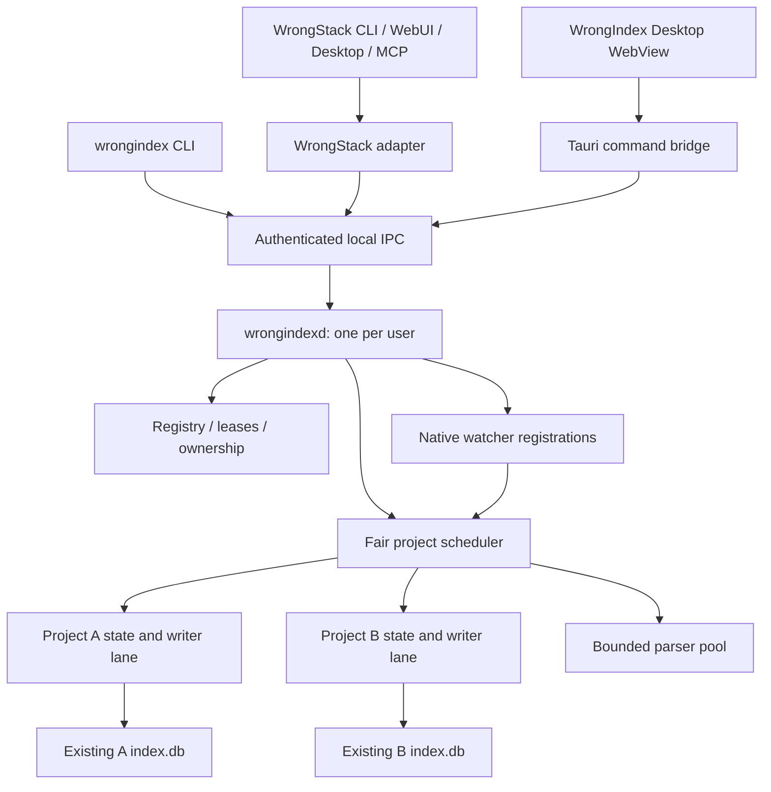

# WrongIndex architecture

Status: proposed. Read [program scope and invariants](README.md) first.

## 1. Process boundaries



Three executable entry points are planned:

- `wrongindexd`: persistent headless service; no WebView dependencies.
- `wrongindex`: CLI client and diagnostics tool; never silently becomes another database writer.
- `wrongindex-desktop`: Tauri application; may start/connect to the daemon but never owns its lifetime.

The native engine may use threads and platform watcher helper threads. The final one-daemon promise means no separate indexing daemon per project and no required Bun/Node indexing engine. The desktop WebView/GUI process tree is separate and must not be counted as an indexing daemon regression.

L1/L2 can start a supervised compatibility worker. Bound its concurrency, child lifetime, memory, and restart policy. Expose the worker backend in diagnostics. Do not spawn the existing unrestricted project-server entry point and call it a single Rust daemon.

## 2. Proposed repository layout

```text
WrongIndex/
  AGENTS.md
  README.md
  Cargo.toml
  Cargo.lock
  rust-toolchain.toml
  package.json
  bun.lock
  .bun-version
  crates/
    wrongindex-contracts/       # protocol DTOs, profile identifiers, errors
    wrongindex-client/          # Rust IPC client used by CLI and desktop
    wrongindex-storage/         # exact index contract + read/write primitives
    wrongindex-registry/        # service database, registrations, job receipts
    wrongindex-discovery/       # Git and filesystem enumeration, ignore rules
    wrongindex-watch/           # OS events, reduction, overflow/reconcile signals
    wrongindex-parser/          # language-independent parser interfaces
    wrongindex-parser-ts/       # TS/JS adapter and parity implementation
    wrongindex-parser-native/   # language modules, split further when justified
    wrongindex-engine/          # project actors, pipeline, graph publication
    wrongindex-ipc/             # authenticated server transport and framing
    wrongindexd/                # daemon entry point and lifecycle
    wrongindex-cli/             # CLI entry point
  apps/desktop/
    src/                        # React views, accessible controls, state
    src-tauri/                  # IPC bridge, tray, window lifecycle
  packages/client-ts/           # Bun-compatible WrongStack client adapter SDK
  packages/legacy-worker/       # transitional engine; excluded from native claims
  contracts/
    profiles/                   # versioned schema and semantic manifests
    protocol/                   # schemas and request/response fixtures
  tests/
    fixtures/                   # small language and filesystem projects
    differential/               # WrongStack vs WrongIndex oracle harness
    integration/                # real IPC/SQLite/process tests
    fault/                      # controlled crashes and queue/watcher faults
    desktop/                    # packaged GUI and lifecycle checks
  benchmarks/
    manifests/                  # corpus generation and machine metadata
    results/                    # machine-readable baseline/results
  scripts/                      # Bun orchestration; no Node command dependency
  docs/
    plan/                       # this package, copied with source map rewritten
    architecture/
    compatibility/
    operations/
```

These module names are boundaries for implementation planning. Avoid creating empty crates solely to match the diagram; the first vertical slice may group them, then extract when a real dependency boundary is exercised. Engine/storage must not depend on Tauri or React.

## 3. State locations and ownership

| Location | Owner | Content |
|---|---|---|
| `~/.wrongindex/config.toml` | WrongIndex | Global policy, resource budgets, startup choice |
| `~/.wrongindex/registry.db` | WrongIndex | Project registrations, job receipts, watch policies, ownership recovery |
| `~/.wrongindex/runtime/` | WrongIndex | Private discovery metadata and endpoint credentials |
| `~/.wrongindex/logs/` | WrongIndex | Bounded structured diagnostics |
| `~/.wrongindex/staging/` | WrongIndex | Recoverable run scratch; quotas and startup cleanup |
| Existing WrongStack project index directories | Index owner negotiated with WrongStack | Existing `index.db` and SQLite sidecars |

No service registry tables are added to `index.db`. Only explicitly negotiated publication/compatibility metadata may be added to its existing metadata table. Index backup paths remain separate from active index ownership and have retention quotas.

Use a configurable user data root through CLI/environment for tests and portable installations. Endpoint identity must incorporate user identity and configured data root, so tests and alternate roots cannot collide with the normal daemon. Define one canonical root for a normal installation; alternate roots are deliberate isolated instances, not the supported default topology.

### 3.1 Project identity

A registration contains:

```text
project_id                  service-local opaque ID
display_name                user-facing label
checkout_root               actual absolute checkout root
canonical_checkout_key      normalized local filesystem identity
index_dir                   absolute location resolved by WrongStack or explicit user input
canonical_index_key         deduplication key for the resolved index location
repository_identity         optional shared coordination/Git identity, never the index key
compatibility_profile       exact storage and semantic profile
watch_policy                session | pinned | manual | disabled
backend                     legacy | native
configuration_revision      monotonically increasing policy revision
```

Windows normalization must handle case-insensitive comparison where applicable, separators, drive roots, UNC syntax, long paths, junctions, symlinks, missing roots, and reparse points. Do not assume lowercasing is a complete canonicalization algorithm; preserve display paths and test filesystem-specific case sensitivity. Resolve existing ancestors for missing paths without following an untrusted escape at registration.

Same index plus same checkout returns the existing project. Same index plus different checkout is rejected as `INDEX_IDENTITY_CONFLICT`. Same checkout plus an explicit different index is allowed only as an intentional alternate registration with independent ownership and visible labeling. Nested repositories remain separate registered projects; shared event observation is an optional optimization, not a reason to mix their indexes.

### 3.2 Registry schema draft

| Table | Essential fields / constraints |
|---|---|
| `registry_metadata` | Schema version and migration history |
| `projects` | ID, roots/keys, profile, policy, backend, config revision; unique canonical index key |
| `project_runtime` | Desired/observed state, owner epoch, dirty revision, last published generation, reconciliation reason |
| `jobs` | Job ID, project ID, kind, dedup key, state, timestamps, attempt, requested revision, committed generation, typed error |
| `job_receipts` | Client/request idempotency key, result/job ID, expiration |
| `project_errors` | Bounded deduplicated error records, first/last occurrence, count, recovery state |
| `ownership_transitions` | Old/new owner, epoch, phase, compatibility profile, recovery evidence |

Client heartbeats are ephemeral in memory. A restarted daemon expires every old session; it does not revive stale leases from the registry. Persist a session summary only for diagnostics. Foreign keys and migration transactions are enabled in the registry. Job and error history require retention limits.

SQLite transactions do not span `registry.db` and `index.db` atomically. The committed index generation and run ID are authoritative for publication; registry updates are replayable bookkeeping. Recovery compares them rather than assuming both commits happened together.

## 4. Project state machine

Keep state in separate dimensions rather than one overloaded status string:

| Dimension | Values |
|---|---|
| Registration | registered, detaching, removed |
| Activity | dormant, attaching, scanning, parsing, committing, reconciling, idle, stopping |
| Freshness | unknown, current, pending, degraded, unavailable |
| Watch health | off, starting, native, polling, overflowed, failed |
| Ownership | unowned, negotiating, owned, conflict, releasing |
| Backend | legacy, native, unsupported |

Example: `activity=idle`, `freshness=degraded`, `watch_health=native` correctly describes a project with a parse failure and an otherwise healthy watcher. Never render this as a healthy green "up to date" state.

Principal transitions:

1. Register -> validate paths/profile -> persist intent -> negotiate ownership -> attach watcher -> initial reconciliation.
2. Valid event -> dirty revision increment -> debounce -> scheduled run -> commit -> freshness recomputed.
3. Last lease expires under session policy -> finish/cancel safely -> stop watcher -> dormant.
4. Pin -> persist policy -> attach/reconcile even with zero clients.
5. Pause -> retain registration and last index -> mark freshness pending/unknown; resume always reconciles.
6. Missing root -> unavailable -> bounded retry/parent observation -> reconcile when restored.
7. Remove -> drain/cancel -> release ownership -> remove registration; preserve source/index by default.
8. Backend/profile change -> safe drain and ownership negotiation -> reconcile before declaring current.

## 5. Startup, singleton election, shutdown

Daemon startup sequence:

1. Resolve user/data root and create private directories with restrictive permissions.
2. Acquire an OS-backed singleton guard and bind the private endpoint. Concurrent starters connect to the winner.
3. Read/migrate the registry, recover interrupted transitions, and mark uncertain projects dirty.
4. Generate an instance ID and private credential; publish discovery metadata atomically.
5. Begin accepting authenticated requests.
6. Restore pinned projects with staggered reconciliation; wait for clients for session-only projects.
7. Emit a ready snapshot containing instance ID and protocol/capability information.

A PID file is descriptive, not the singleton lock. PID reuse is not evidence that an endpoint is stale. Unix stale socket recovery must check parent ownership and a failed live handshake before unlinking; Windows pipe security must restrict access to the user SID. Crash recovery must not terminate arbitrary processes based on a stale PID.

Shutdown sequence: stop admission of new writes; report draining; bound completion of current publication; cancel parse tasks cooperatively; roll back unfinished transaction; persist dirty/reconcile intent; close readers/writers/watchers; release ownership; remove only this instance's discovery metadata. Default drain budget: 15 seconds, configurable and validated by tests. Forced termination remains crash recovery, not successful graceful shutdown.

## 6. Watch and activation policies

| Policy | Watch starts | Watch stops | Restart behavior |
|---|---|---|---|
| `session` default | At least one authorized client lease | Last lease expires plus grace period | Wait for new session |
| `pinned` | Registration enabled and daemon available | Explicit pause/disable/removal | Reattach and reconcile |
| `manual` | Explicit index job; temporary observation may cover that run | Job completes | Remain dormant |
| `disabled` | Never automatically | Immediately after safe drain | Remain disabled |

Initial proposals: client heartbeat 15 seconds, lease 60 seconds, last-client grace 120 seconds. These differ from the current project's daemon and require integration tests, not silent reuse. An active manual job is not canceled solely because its requesting socket disconnects; cancellation semantics are explicit per job.

WrongStack registration does not silently pin every project ever opened. GUI pinning is durable user intent. Autostart of the user daemon and pinned-project watching are separate settings.

## 7. Scheduling and resource policy

- One mutable project state owner and one serialized publication lane per index.
- Blocking SQLite work runs outside the async reactor on dedicated/bounded blocking lanes. Never hold a synchronous connection across arbitrary async tasks.
- Parser slots are shared across projects; no unbounded `spawn_blocking` queue.
- Default parser slots: `min(4, max(1, available_parallelism - 1))` as an initial configurable proposal.
- Default concurrent full scans: 1; interactive incremental work can progress in bounded slices between scan batches.
- Weighted fair scheduling across projects; age jobs to prevent starvation.
- Separate admission budgets for interactive queries and indexing; queries must remain cancelable during large updates.
- Per-project event queue capped initially at 10,000 distinct paths; on overflow collapse to one reconcile marker.
- Debounce 400 ms and coalescing 50 ms initially match current defaults; maximum burst wait 2 seconds prevents endless postponement.
- Bound parser input bytes, output symbols/refs, open handles, staging bytes, and per-client frames. Exceeding a bound is an explicit error/degradation, not silent file omission.
- Hot database connection retention is an LRU constrained by a global memory budget; dormant projects do not each retain a large SQLite cache.

All these are initial policy targets. Measure and tune using the benchmark program before freezing 1.0 defaults.

## 8. IPC protocol

### 8.1 Transport and negotiation

Use a WrongIndex-specific endpoint namespace. Do not imitate a current project daemon's artifact hash or publish legacy `server.json` metadata to trick old clients into adopting the service.

Start with bounded length-prefixed UTF-8 JSON frames for the new protocol. Define the prefix as a 32-bit unsigned little-endian byte length; initial maximum request/response frame 8 MiB. Paginate large results and cap aggregate response budgets. The legacy framing adapter, if needed for preview, remains an explicit separate boundary; current JS character limits are not byte limits. MessagePack is deferred until a measured need exists.

Handshake negotiates:

```text
protocol_major, protocol_minor
client_name, client_version
daemon_instance_id, daemon_version
supported_profile_ids, selected_profile_id
capabilities: [register, watch, query, graph, context, vector, ...]
limits: max_frame_bytes, max_page_size, max_inflight
```

Authentication precedes project data, health details containing paths, and mutations. Tokens stay in owner-private files and native client memory; never expose them to the WebView, hello responses, command-line arguments, or logs. Token rotation on restart requires reconnect discovery. Validate OS ownership/ACLs as well as token possession.

### 8.2 Envelope and methods

```json
{
  "protocol": 1,
  "requestId": "client-scoped-opaque-id",
  "method": "index.request",
  "projectId": "registered-project-id",
  "params": {"kind": "incremental", "paths": ["src/main.ts"]},
  "idempotencyKey": "optional-retry-key"
}
```

Authenticate the connection through a dedicated initial frame; the example does not carry a secret. Validate every method and payload before admission.

| Group | Proposed methods |
|---|---|
| Daemon | `daemon.hello`, `daemon.health`, `daemon.shutdown` |
| Projects | `project.register`, `project.list`, `project.get`, `project.configure`, `project.detach` |
| Session | `session.acquire`, `session.heartbeat`, `session.release` |
| Work | `index.request`, `job.get`, `job.cancel`, `job.list` |
| Read | `index.search`, `index.stats`, `graph.packages`, `graph.files`, `graph.symbols`, `calls.incoming`, `calls.outgoing`, `context.query`, `vector.search` |
| Events | `events.subscribe`, `events.snapshot` |
| Maintenance | `index.check`, `index.checkpoint`, `index.backup`, `diagnostics.export` |

Mutating requests acknowledge durable admission with a job ID; completion is distinct from acceptance. `job.cancel` is scoped to authorized job/project access. Do not transfer the old protocol's per-socket request cancellation semantics to durable jobs without defining the difference.

### 8.3 Read freshness and event delivery

Responses include `daemonInstanceId`, `projectId`, `indexEpoch`, `generation`, `freshness`, and `observedAt`. A `minGeneration` option can wait for a known commit with a deadline. Rebuilds use a new index epoch so a lower generation is not mistaken for a regression from the same database lineage.

Event stream: per-instance monotonically increasing sequence number; bounded replay buffer; snapshot on gaps or instance change. Event types: project state, progress, generation committed, job completed/failed, watch health, and resource warning. Slow clients receive coalesced progress; mandatory completion is recoverable through `job.get` and snapshots. Never retain unbounded event history for one disconnected GUI.

Stable typed errors: `UNAUTHENTICATED`, `FORBIDDEN`, `PROTOCOL_UNSUPPORTED`, `PROFILE_UNSUPPORTED`, `INDEX_IDENTITY_CONFLICT`, `OWNER_CONFLICT`, `PROJECT_UNAVAILABLE`, `QUEUE_SATURATED`, `INDEX_DEGRADED`, `DATABASE_BUSY`, `DATABASE_CORRUPT`, `READ_ONLY`, `DISK_FULL`, `CANCELED`, `DEADLINE_EXCEEDED`, and `INTERNAL`. Responses indicate retryability without leaking source snippets or secrets.

## 9. Recovery boundaries

| Failure | Required behavior |
|---|---|
| Daemon panic/crash | SQLite rollback/recovery; recover committed generation; unfinished jobs retry only when idempotent |
| Parser panic | Catch at task boundary where safe; preserve last good file; fail/degrade project; other projects continue |
| Native memory corruption/abort | Entire daemon may die; acknowledge weaker isolation than preview workers; watchdog/recovery tests |
| Watcher failure | Mark dirty, attempt reattach, optionally polling; show unavailable/degraded state |
| Root disappears | Preserve rows and registration; do not bulk-delete from an incomplete scan |
| Disk full | Roll back write, bound logs/staging, report failure, retry only after space is available |
| Registry fails | Refuse new mutable work if durable admission cannot be recorded |
| Commit succeeds, registry/event update fails | Recover from authoritative run/generation in index metadata |
| Corruption | Stop writes, retain diagnostic evidence, offer verified rebuild; never silently erase optional data |
| Project registration changes during parse | Reject obsolete run by config revision/owner epoch; enqueue fresh reconciliation |

Rust does not provide process-level crash isolation between project actors. This is an explicit tradeoff of the one-process requirement. If unsafe parser dependencies prove unacceptable, propose an optional isolated worker mode separately, with its process cost disclosed.

## 10. Security boundaries

- Same-user local access is the trust model; this is not a sandbox against arbitrary malicious code already executing as that user.
- Filesystem containment and explicit symlink policy prevent a registered project from silently expanding to unrelated trees.
- No project scripts, Cargo builds/macros, Python imports, TS plugins, or package lifecycle hooks run during indexing.
- Git discovery uses argument arrays and bounded output; paths never become shell fragments.
- UI uses scoped Tauri commands, CSP, no remote WebView content, and no general-purpose shell/filesystem bridge. See [Tauri security](https://v2.tauri.app/security/).
- Diagnostic exports redact tokens, environment variables, source text, home paths where possible, and provider credentials.
- IPC slowloris, oversized frames, excess subscriptions, and excessive query costs have explicit limits.
- No telemetry or source upload by default. Any enrichment/network provider is a separately enabled feature.
