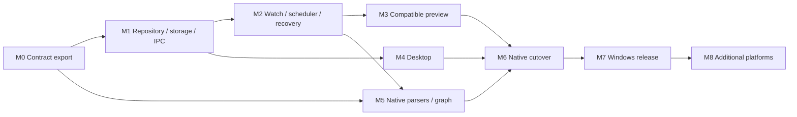

# Delivery backlog and execution order

Status: proposed backlog. All tasks are unchecked; IDs are stable for a future issue tracker. No task below is completed by the existence of this document.

## 1. Dependency map

Parallel implementation is possible later after contracts stabilize; this plan does not require spawning agents or editing multiple repositories immediately. Keep production ownership changes behind staged feature flags until their milestone gates pass.

## 2. M0 — Freeze the existing contract

Outcome: executable specification of the real WrongStack index and consumers.

| ID | Task | Dependencies | Acceptance evidence |
|---|---|---|---|
| WI-000 | Capture clean source baseline and working-tree/file hashes | None | Immutable commit/artifact manifest; unrelated WIP excluded |
| WI-001 | Export DDL, pragmas, metadata keys, repair behavior, optional features | WI-000 | SQLite fixture introspection plus source map |
| WI-002 | Export full language/extension/backend/helper inventory | WI-000 | Every current route classified; subprocess list recorded |
| WI-003 | Inventory every index writer and mutable constructor | WI-000 | Startup, fallback, maintenance, vectors, concepts, tools, GUI hosts covered |
| WI-004 | Capture query/API request and response fixtures | WI-001 | Search/stats/graphs/calls/context/vectors plus model-facing consumers |
| WI-005 | Build representative multilingual fixture corpus | WI-002 | Normal/boundary/error/control cases with expected behavior |
| WI-006 | Build WrongStack oracle harness under pinned Bun | WI-004, WI-005 | Fixture indexes and operation outputs reproducibly regenerated |
| WI-007 | Specify storage/semantic profile manifest | WI-001..006 | Full profile fingerprint and supported-client policy |
| WI-008 | Record baseline performance and process tree | WI-006 | Cold/warm/no-op/edit measurements with machine metadata |
| WI-009 | Review extracted-code licenses and attribution | WI-000 | Allowed reuse/distribution strategy documented |

Exit gate: fixtures can be regenerated from the captured source; unknown writer paths and feature side effects are resolved. No native writer uses a real production index yet.

## 3. M1 — Standalone skeleton, storage, and IPC

Outcome: independent repository with a safe daemon/client/storage vertical slice.

| ID | Task | Dependencies | Acceptance evidence |
|---|---|---|---|
| WI-100 | Create separate repo, scoped AGENTS, Cargo/Bun pins, CI | M0 profile | Clean checkout builds without WrongStack workspace aliases |
| WI-101 | Validate current dependency/MSRV/engine/grammar versions | WI-100 | Registry snapshot, selected pins, compatibility notes |
| WI-102 | Implement contracts crate and TS DTO/schema generation | WI-007 | Shared fixtures round-trip JS/Rust without semantic loss |
| WI-103 | Implement private data-root and endpoint resolution | WI-102 | User/root isolation and ACL tests |
| WI-104 | Implement singleton election and discovery | WI-103 | Concurrent starts elect exactly one daemon |
| WI-105 | Implement framed/authenticated IPC and bounded admission | WI-102..104 | Partial/oversized/unauthorized/slow-client tests |
| WI-106 | Implement registry migrations and job receipts | WI-100 | Durable admission, interrupted-migration recovery |
| WI-107 | Implement read-only schema/profile inspector | WI-001, WI-105 | Unknown/newer schema left unchanged |
| WI-108 | Port storage write/read primitives into temp fixtures | WI-107 | DDL/FTS/hash/ID/vector fixture parity |
| WI-109 | Implement ownership guard/epochs and transfer journal | WI-003, WI-106 | Concurrent owners and stale tasks rejected |
| WI-110 | CLI daemon status/start/stop and doctor | WI-105..109 | CLI-only install can diagnose fixture project |

Exit gate: a real named-pipe client connects, authenticates, admits a fixture job, and obtains a durable result; no GUI or parser mocking is used to claim this vertical slice works.

## 4. M2 — Project lifecycle, watcher, scheduler

Outcome: multi-project supervision with bounded background work and recovery.

| ID | Task | Dependencies | Acceptance evidence |
|---|---|---|---|
| WI-200 | Project register/list/configure/detach | M1 | Idempotency, collision, missing-root, no-delete behavior |
| WI-201 | Session leases and pin/manual/disabled policies | WI-200 | Multiple clients, disconnect, restart, pin persistence |
| WI-202 | Native watcher adapter and platform event normalization | WI-200 | Actual Windows save/rename/delete/dir tests |
| WI-203 | Versioned dirty sets, debounce, coalescing, max wait | WI-202 | Burst/continuous-save/duplicate-event behavior |
| WI-204 | Fair scheduler and bounded parser/blocking slots | WI-203 | Small edit progresses beside large scan; no unbounded queue |
| WI-205 | Complete/incomplete discovery and ignore semantics | WI-005, WI-202 | Exact eligible set; failure never mass-deletes |
| WI-206 | Attach scan with event buffering/revalidation | WI-203..205 | Edits during initial scan converge correctly |
| WI-207 | Overflow, restart, sleep/resume, root restore reconciliation | WI-206 | Injected event loss repaired; freshness truthful |
| WI-208 | Job cancel, deadlines, retry/circuit policy | WI-204..207 | Cancel/commit ambiguity and transient failures resolved |
| WI-209 | Structured metrics/logs and quotas | WI-204 | Bounded logs/staging/dirty sets and measurable phase durations |

Exit gate: at least three fixture projects are watched simultaneously; edits, deletes, overflow, and restart converge without mixing identities. This gate tests supervision independently of claiming native parser parity.

## 5. M3 — Compatible hybrid preview and WrongStack adapter

Outcome: real supported WrongStack sessions use the existing databases through WrongIndex.

| ID | Task | Dependencies | Acceptance evidence |
|---|---|---|---|
| WI-300 | Define non-electing compatibility worker entry point | M0, M1 | No independent project-server startup or ownership election |
| WI-301 | Package bounded worker execution and crash handling | WI-300, M2 | Worker limits/restart/cancel/failure observability |
| WI-302 | Route full/incremental requests and all baseline read ops | WI-301 | Existing query fixture suite passes via real daemon |
| WI-303 | Add WrongStack transport selection/config parsing | WI-102, WI-302 | local/wrongindex/auto modes and validation covered |
| WI-304 | Route startup/edit hooks and prevent unsafe fallback | WI-003, WI-303 | Real write/edit/patch/format/AST paths verified |
| WI-305 | Enforce ownership across all supported mutable consumers | WI-109, WI-304 | Direct constructors/enrichment/maintenance respect owner |
| WI-306 | Implement generation/event/cache invalidation across hosts | WI-302..305 | Warm caches see changes from another client |
| WI-307 | Integrate WebUI/desktop/MCP leases and health views | WI-306 | Concurrent real surfaces share one index owner |
| WI-308 | Implement backup, supported takeover, rollback | WI-305 | Transfer interruption and rollback restore a supported owner |
| WI-309 | Publish preview limitations and adapter minimum | WI-307..308 | No "fully native" claim; process tree documented |

Exit gate: CLI, WebUI, and MCP queries observe the same edited project generation; client shutdown releases only its lease; daemon failure cannot create concurrent local/remote writers. Unknown old clients remain a documented admission blocker.

## 6. M4 — Desktop product

Outcome: useful GUI backed by live daemon behavior.

| ID | Task | Dependencies | Acceptance evidence |
|---|---|---|---|
| WI-400 | Tauri shell, narrow commands, Rust shared IPC client | M1 | UI cannot read secret token/general filesystem through bridge |
| WI-401 | Overview/project list/state model | WI-400, WI-200 | Connecting/stopped/degraded/current states shown truthfully |
| WI-402 | Add/import project and ownership conflict flows | WI-401, WI-308 | Existing index reuse validated; no silent mass pinning |
| WI-403 | Project detail/progress/errors/actions | WI-402, M2 | Pause/resume/reconcile/pin/retry applied by daemon |
| WI-404 | Jobs/activity and reconnect snapshot logic | WI-403 | Missed event sequences recover without false success |
| WI-405 | Settings/resource controls/diagnostic export | WI-209, WI-404 | Failed writes stay failed; redaction tested |
| WI-406 | Tray and close/quit/stop lifecycle | WI-400 | GUI close/crash leaves daemon and watchers alive |
| WI-407 | Accessibility/DPI/theme/long-path review | WI-401..406 | Keyboard/screen reader/manual native evidence |
| WI-408 | Packaged desktop smoke | WI-407 | Installed GUI controls an installed background daemon |

Exit gate: the user can add a project, continuously watch it, inspect failures, pause/resume, close/reopen the GUI, and see index updates without a running WrongStack session when pinned.

## 7. M5 — Native engine and semantic parity

Outcome: each baseline parser/graph capability is implemented and independently gated.

| ID | Task | Dependencies | Acceptance evidence |
|---|---|---|---|
| WI-500 | Rust parser interface, bounded outputs, grammar asset provenance | M0, M1 | Outcome semantics and resource constraints |
| WI-501 | Content/structural fingerprint and Unicode position parity | WI-500 | Cross-runtime known-answer fixtures |
| WI-502 | JSON/YAML/config native first write slice | WI-108, WI-501 | Same SQLite file consumed by current supported WrongStack |
| WI-503 | Generic/source inclusion and tree-sitter route parity | WI-502 | Full language-extension map and fallback fixtures |
| WI-504 | Rust parser semantic port | WI-503 | Imports, scopes, signatures, calls, positions, helper removal |
| WI-505 | TS/JS compiler-output parity spike | WI-006, WI-500 | Quantified differences and chosen native strategy |
| WI-506 | TS/JS/TSX/JSX parser implementation | WI-505 | All baseline declaration/import/call fixtures pass |
| WI-507 | Go parity spike and native implementation | WI-500 | Package/import/qualified refs and helper-free evidence |
| WI-508 | Python parity spike and native implementation | WI-500 | Scopes/imports/decorators/calls and helper-free evidence |
| WI-509 | Native ref ownership, target repair, module/package relations | WI-502..508 | Rename/delete/re-export/manifest-change parity |
| WI-510 | Native import-aware binding and graph rank | WI-509 | Call graph/centrality fixtures and no-op behavior |
| WI-511 | Native FTS/BM25/context/vector query behavior | WI-108, WI-510 | All negotiated query operations pass differential tests |
| WI-512 | Optional enrichment preservation and SAGE integration | WI-509..511 | Current-profile side effects retained or explicitly gated |
| WI-513 | Large-run staging/atomic publication benchmark | M2, WI-510 | No partial generations and measured query availability |
| WI-514 | Full native profile certification | WI-503..513 | No unexplained parity differences; no required legacy engine |

Exit gate: all languages in the declared current-compatible profile pass. Per-language experimental support may ship earlier, but it cannot satisfy the full-profile gate. An unresolved TS/JS semantic gap is a blocker, not permission to relabel a reduced parser as equivalent.

## 8. M6 — Native takeover and hardening

Outcome: production-shaped native service with reversible supported-client integration.

| ID | Task | Dependencies | Acceptance evidence |
|---|---|---|---|
| WI-600 | Switch preview backend to native per project | M3, M5 | Drain/epoch/profile transition and reconciliation |
| WI-601 | Crash/fault injection through every publication boundary | WI-600 | Atomic rollback, commit recovery, stale-output rejection |
| WI-602 | Multi-project soak and resource tuning | WI-601 | Defined workload, plateauing handles/threads/RSS, fair queues |
| WI-603 | SQLite maintenance/backups/corruption recovery | WI-601 | Read retention/WAL/disk-pressure/rebuild evidence |
| WI-604 | Ownership/protocol/GUI security review | WI-600, M4 | Findings reproduced, fixed, and revalidated |
| WI-605 | Safe default/auto integration rollout | WI-602..604 | No unsafe fallback; old client minimum enforced/documented |
| WI-606 | Native process-tree certification | WI-605 | No Bun/Node engine or per-project daemon/helper requirement |

Exit gate: Windows native release profile passes functional, fault, compatibility, security, and soak gates on installed builds. GUI and indexing processes are counted separately and transparently.

## 9. M7 — Windows release

| ID | Task | Dependencies | Acceptance evidence |
|---|---|---|---|
| WI-700 | Per-user installer and headless package | M6 | Fresh-machine install without source/developer runtime |
| WI-701 | Autostart/update/uninstall/rollback flows | WI-700 | User-session reboot, version transition, ownership cleanup |
| WI-702 | Release docs and operations runbooks | WI-700..701 | Commands exercised against installed artifacts |
| WI-703 | Exact-commit CI, provenance, licenses, checksums/signing | WI-702 | Artifact manifest linked to source and supported profile |
| WI-704 | Downloaded artifact smoke and WrongStack live proof | WI-703 | Real edit -> same SQLite -> actual tool queries -> GUI state |
| WI-705 | Publish native 1.0 release evidence | WI-704 | Requirement matrix has no hidden NOT RUN/unsupported claims |

M8 adds Linux/macOS packaging, socket/permission/watch backend tests, user services/LaunchAgents, and platform-specific installed-artifact evidence. A cross-compile is not platform acceptance.

## 10. Effort and scheduling assumptions

Planning estimates for one experienced engineer, full-time, with review access and no pre-existing reusable WrongIndex engine. These are uncertainty ranges, not promised dates:

| Workstream | Engineering effort |
|---|---|
| M0 baseline/oracle/profile | 1–2 weeks |
| M1 independent storage/IPC/skeleton | 1–2 weeks |
| M2 watcher/scheduler/recovery | 1–2 weeks |
| M3 compatibility worker and WrongStack adapter | 2–3 weeks |
| M4 useful desktop product | 1.5–3 weeks |
| M5 complete native semantic parity | 6–12+ weeks |
| M6 hardening and soak | 2–4 weeks |
| M7 Windows packaging/release | 1–2 weeks |

A useful hybrid preview is approximately 6–10 weeks of focused elapsed work with some GUI/integration overlap. The full native objective is more plausibly a 16–30+ engineering-week program. TS/JS and Go/Python semantic parity can extend it. Re-estimate after M0 and WI-505/507/508; do not compress the plan by silently dropping baseline capabilities.

## 11. Initial ten implementation sessions

| Session | Concrete output |
|---|---|
| 1 | Refresh this plan against source; capture immutable baseline and all relevant source hashes |
| 2 | Export SQLite contract fixtures and every mutable consumer inventory |
| 3 | Freeze multilingual/query fixtures and baseline oracle results |
| 4 | Create separate repository; pin toolchains/dependencies after live preflight |
| 5 | Implement private endpoint/singleton and Rust/TS handshake fixtures |
| 6 | Implement registry/job admission and read-only index inspector |
| 7 | Demonstrate temp-index native storage/FTS compatibility |
| 8 | Implement registration/leases and ownership guard for cooperating clients |
| 9 | Implement Windows watcher/dirty queue with real filesystem integration tests |
| 10 | Demonstrate three watched fixture projects and restart reconciliation; reassess estimates |

Sessions are ordering units, not guaranteed one-day tasks. End each with source/validation evidence and an explicit next task ID.

## 12. Separate-project handoff prompt

Use this as a starting instruction when implementation is requested:

> Start WrongIndex in the explicitly selected separate directory. Read the complete WrongIndex plan package before editing. Preserve the WrongStack main checkout and unrelated dirty work. Implement M0 and the smallest M1 vertical slice first. Refresh dependency/toolchain registries, capture immutable source contracts, and use only disposable fixture indexes until ownership/profile gates exist. Do not claim the preview is fully native. Keep existing SQLite locations and semantic/query behavior, prevent concurrent writer fallback, and report exact tests and remaining milestone gates. Do not publish, install autostart, or replace the user's live index as part of bootstrap unless separately requested.

When copying the plan, preserve a source map to the captured WrongStack commit and rewrite relative links to that immutable source or a local reference checkout. The standalone repository must not depend on uncommitted WrongStack files or an absolute local path to build.
