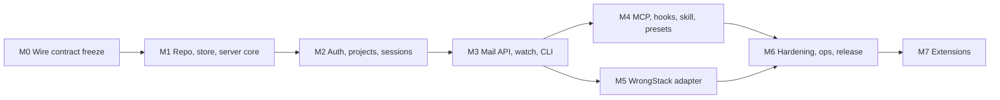

# Delivery backlog, dependencies, and separate-project kickoff

Status: proposed. All task IDs below are unimplemented by this planning task.

## 1. Milestone dependency graph

Contracts stabilize before overlapping implementation. This plan does not authorize edits to external tool configuration, server provisioning, or WrongStack source.

## 2. M0 — Freeze the wire contract

Outcome: `wm1` is an executable specification derived from the current WrongStack mailbox.

| ID | Task | Depends on | Acceptance evidence |
|---|---|---|---|
| WMB-000 | Record WrongStack source commit and hashes of mailbox contract files | None | Manifest committed in the new repo |
| WMB-001 | Export message types, address normalization, audience, receipt, TTL, and type/address rules as JSON fixtures | WMB-000 | Fixtures cover every type × address form, including rejections (`assign` to `*`, `control`) |
| WMB-002 | Capture actor-view derivation (`read_by_me`, `completed_by_me`, `action_required_for_me`) as fixtures | WMB-001 | Broadcast/alias multi-actor cases |
| WMB-003 | Capture current Mailbox MCP tool/operation inventory and skill loop | WMB-000 | Generated inventory; differences in `wm1` listed |
| WMB-004 | Write `wm1` JSON Schemas (DTOs, errors, events) and extension rules | WMB-001..003 | Schemas validate all fixtures; unknown-field tolerance tested |
| WMB-005 | Fence fixture suite (delimiter injection, Unicode confusables, nested fences) | WMB-004 | Fixture inputs and expected outputs |
| WMB-006 | Secret-scan rule fixtures (true and false positives) | None | Includes known token shapes and look-alikes |

Exit gate: fixtures and schemas are reviewed and frozen as `wm1-rc1`.

## 3. M1 — Repository, storage, server skeleton

| ID | Task | Depends on | Acceptance evidence |
|---|---|---|---|
| WMB-100 | Create Cargo workspace (`wrongmail-proto`, `-store`, `-core`, `wrongmaild`, `wrongmail`), AGENTS.md, CI (fmt, clippy, test) | M0 | Clean checkout builds without WrongStack paths |
| WMB-101 | Dependency preflight: refresh crates.io, choose rusqlite 0.41.1 vs 0.42.x, verify tower-http/axum/rate-limit compatibility, MSRV, licenses | WMB-100 | Pinned `Cargo.lock`, `rust-toolchain.toml`, compatibility notes |
| WMB-102 | Proto crate from `wm1` schemas; JSON Schema + TypeScript type export | WMB-004, WMB-100 | Round-trip of all fixtures |
| WMB-103 | Registry and project schemas, embedded migrations, newer-version refusal | WMB-100 | Migration tests; newer schema opened read-only, bytes unchanged |
| WMB-104 | Writer actor + read pool per database; bounded queues; idle shutdown | WMB-103 | Concurrency test: N writers, no `SQLITE_BUSY` surfaced to callers |
| WMB-105 | Event table, `seq` assignment, in-memory hub, resync | WMB-104 | Commit-before-notify test; restart preserves cursors |
| WMB-106 | `serve` with config, loopback listener, `/healthz`, structured logs, graceful shutdown | WMB-100 | Process test: SIGTERM drains and checkpoints |

Exit gate: server starts, migrates, and serves health on loopback with persistent `seq`.

## 4. M2 — Authentication, projects, sessions

| ID | Task | Depends on | Acceptance evidence |
|---|---|---|---|
| WMB-200 | `admin init`, pepper, operator credential | WMB-103 | Credential printed once; only hash stored |
| WMB-201 | Token format, HMAC verification, constant-time compare, `last_used_at` throttling | WMB-200 | Unit + timing-insensitive tests; tokens absent from logs |
| WMB-202 | Projects, link rules, git-remote normalization | WMB-103 | Normalization fixtures (SSH/HTTPS/credentials/`.git`/case) |
| WMB-203 | Enrollment codes and exchange; principal credential issue/rotate/revoke | WMB-201 | Single-use, expiry, overlap window, revoke closes sessions |
| WMB-204 | Grants: capabilities, agent-name pattern, session caps, expiry | WMB-202 | Authorization matrix tests |
| WMB-205 | Sessions: open, heartbeat, presence TTL, close; agent ID assignment | WMB-204 | Sender binding; session cannot cross project |
| WMB-206 | Audit log | WMB-200 | All listed actions recorded; no bodies/secrets |
| WMB-207 | Rate limiting and auth-failure lockout | WMB-201 | 429 behavior and `Retry-After` |

Exit gate: an enrolled principal can open a session only for granted projects and agent names; revocation is immediate.

## 5. M3 — Mail API, watch, CLI

| ID | Task | Depends on | Acceptance evidence |
|---|---|---|---|
| WMB-300 | Send with idempotency, type/address validation, thread derivation, refs | M2, WMB-001 | `wm1` fixtures pass on the real HTTP path |
| WMB-301 | Query/actor view/unread-count/thread with visibility before pagination | WMB-300 | Hidden-message probes return 404/omitted, counts do not leak |
| WMB-302 | Acks (bulk), soft-delete/restore, admin purge | WMB-300 | Per-actor receipt fixtures |
| WMB-303 | Retention sweeper and profiles | WMB-302 | TTL fixtures with injected clock |
| WMB-304 | SSE watch and long-poll with per-session filtering and resync | WMB-105, WMB-301 | Events never include bodies; invisible events never delivered |
| WMB-305 | Secret scanner (server) with reject/redact | WMB-006 | Fixture suite |
| WMB-306 | `wrongmail` client: config, credential store, `enroll`, `link`, `whoami`, `doctor` | M2 | Works against loopback and TLS test server |
| WMB-307 | CLI mail commands, local cursor, `watch --exec`, JSON output, local secret pre-scan | WMB-300..305 | End-to-end CLI tests |
| WMB-308 | Offline outbox with idempotent flush | WMB-307 | Kill-connection-after-commit test produces no duplicate |
| WMB-309 | Built-in TLS listener option; proxy-trust handling | WMB-106 | TLS tests; forwarded headers ignored from untrusted peers |

Exit gate: two CLI agents on two machines (or two network namespaces) hold a threaded conversation with correct receipts.

## 6. M4 — MCP, hooks, skill, presets

| ID | Task | Depends on | Acceptance evidence |
|---|---|---|---|
| WMB-400 | `rmcp` protocol-revision spike: stdio and Streamable HTTP, modern and legacy client eras | WMB-101 | Conformance notes; gaps documented |
| WMB-401 | Four tier tools with schemas generated from proto; capability-filtered listing | WMB-400, M3 | Tool inventory matches spec; ungranted ops rejected server-side |
| WMB-402 | `wrongmail mcp` stdio bridge: lazy session, heartbeat, EOF close, stderr logs | WMB-401 | Stdio framing tests; EOF never stops the server |
| WMB-403 | `/mcp` Streamable HTTP endpoint with Origin/Host validation | WMB-401 | Browser-origin rejection test |
| WMB-404 | Fenced text projections for all model-facing outputs | WMB-005, WMB-401 | Fence fixtures pass through MCP and hook outputs |
| WMB-405 | `wrongmail hook` with all events and formats; time budget; fail-open; continuation budget | WMB-307, WMB-404 | Hook tests with server down, slow, and returning errors |
| WMB-406 | `wrongmail` skill and instruction snippets | WMB-401 | Skill review; no secrets |
| WMB-407 | Per-tool preset research from official docs (MCP config location, hook events, output formats) | WMB-405 | Dated source list per tool |
| WMB-408 | `wrongmail setup <tool>` with `--dry-run`/`--write`, no token writes | WMB-407 | Golden files per tool |
| WMB-409 | Client smoke tests for first wave (Claude Code, Codex, Gemini CLI, Cursor) | WMB-408 | Recorded versions and passing layers |

Exit gate: at least two different vendors' tools converse through MCP, with hook-based inbox injection verified for at least one.

## 7. M5 — WrongStack adapter

| ID | Task | Depends on | Acceptance evidence |
|---|---|---|---|
| WMB-500 | Adapter design review with WrongStack maintainers (port shape, control split, credential storage) | M3 | Accepted ADR in WrongStack repo |
| WMB-501 | `WrongMailMailbox` implementing the `Mailbox` port; backend selection per project | WMB-500 | Existing mailbox contract tests run against the adapter |
| WMB-502 | SSE-to-mailbox-event bridge for TUI/WebUI/HQ | WMB-501 | Surfaces refresh on remote sends |
| WMB-503 | `wstack mailbox export --format wm1` through `RemoteMailbox`; `admin import-jsonl` | WMB-501 | Round-trip preserves IDs, timestamps, receipts |
| WMB-504 | Link/unlink commands; local store conversation writes disabled when linked | WMB-501 | Single-authority test (WMB-INV-16) |
| WMB-505 | Telegram and other bridges post with `external-bridge` trust | WMB-501 | Fence test end-to-end |

Exit gate: a linked WrongStack project and an external tool exchange mail with no message written to the local `_mailbox.sqlite` conversation plane.

## 8. M6 — Hardening, operations, release

| ID | Task | Depends on | Acceptance evidence |
|---|---|---|---|
| WMB-600 | Backup/restore/migrate commands and restore drill | M3 | Drill report |
| WMB-601 | Metrics endpoint, doctor commands, alerts examples | M3 | Metrics scrape test |
| WMB-602 | Packaging: static Linux, Windows, macOS binaries; container; checksums and signatures | M4 | Installed-artifact tests |
| WMB-603 | systemd/LaunchAgent/Windows user service recipes | WMB-602 | Install/uninstall tests |
| WMB-604 | Security review and fuzzing (HTTP parsers, address parser, fence, secret scanner) | M4 | Findings closed or accepted |
| WMB-605 | Performance runs against capacity targets | M4 | Reproducible benchmark report |
| WMB-606 | Operator and user documentation, support matrix | WMB-409, M5 | Published docs with tested versions |

Exit gate: [Validation](validation.md) release proof complete.

## 9. M7 — Extensions (individually gated)

Web console (read-only inbox/threads/presence for operators), WebSocket transport, MCP resources/subscriptions after client conformance, additional client presets, workspaces (multi-team tenancy), optional end-to-end encrypted projects, server federation.

## 10. Separate-repository kickoff

1. Create `D:\Codebox\PROJECTS\WrongMail` (or the chosen remote) with `README.md`, `AGENTS.md`, Cargo workspace, `rust-toolchain.toml`, license.
2. Copy this plan package as `docs/plan/` with a pointer back to the WrongStack commit it was written against.
3. Run M0 against the WrongStack checkout read-only; WrongStack is a source of fixtures, not a build dependency.
4. Keep the WrongStack adapter (M5) in the WrongStack repository, consuming the generated `wm1` TypeScript types as a pinned artifact.

## 11. Rough sizing (planning estimate, not a commitment)

| Milestone | Engineer-weeks |
|---|---:|
| M0 | 1 |
| M1 | 2 |
| M2 | 2 |
| M3 | 3 |
| M4 | 3 |
| M5 | 2 |
| M6 | 2 |
