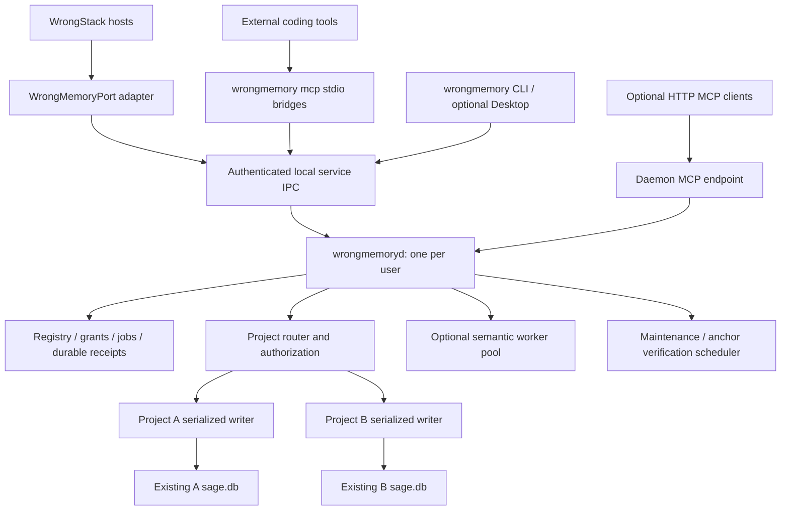

# Architecture, project identity, and durable storage

Status: proposed; [research](sage-system-research.md) describes current SAGE behavior.

## 1. Process topology



Every ingress uses the same authorization, validation, revision, and mutation service. MCP is a transport/product adapter, not a second implementation of memory rules. A CLI bridge never opens SQLite. The native daemon contains no required WebView, Bun, or WrongStack runtime.

Normal executables: `wrongmemoryd`, `wrongmemory`, and optional `wrongmemory-desktop`. `wrongmemory mcp` is a short-lived client-owned bridge mode. Closing its stdin terminates the bridge, releases its service lease, and leaves the daemon alive.

The optional HTTP MCP endpoint is hosted by the daemon, not one listener/process per project. Project-scoped credentials and routing select authorized stores. Remote binding is deferred; loopback is disabled until explicitly configured.

## 2. Proposed code boundaries

```text
WrongMemory/
  Cargo.toml / Cargo.lock / rust-toolchain.toml
  package.json / bun.lock / .bun-version
  AGENTS.md
  crates/
    wrongmemory-contracts/       # records, DTOs, typed errors, profile IDs
    wrongmemory-storage/         # SAGE SQLite, codec, migrations, FTS, backups
    wrongmemory-graph/           # anchors, relationship/traversal rules
    wrongmemory-retrieval/       # lexical/path/audience/ranking/cursors
    wrongmemory-policy/          # grants, sessions, visibility, input rules
    wrongmemory-lifecycle/       # candidates, feedback, hygiene, recovery
    wrongmemory-semantic/        # optional vectors/provider adapter
    wrongmemory-registry/        # service state, grants, ownership, jobs
    wrongmemory-service/         # shared use cases and mutation coordination
    wrongmemory-ipc/             # private authenticated IPC
    wrongmemory-mcp/             # rmcp facade/transport-era compatibility
    wrongmemory-client/          # Rust service client
    wrongmemoryd/                # daemon entry point
    wrongmemory-cli/             # CLI and stdio bridge entry points
  packages/client-ts/            # Bun-compatible WrongStack adapter client
  packages/legacy-worker/        # bounded migration preview only
  apps/desktop/                  # optional Tauri management GUI
  contracts/profiles/            # immutable storage/semantic baseline
  integrations/                  # client preset schemas and guidance
  tests/fixtures/                # isolated projects and SAGE databases
  tests/differential/             # captured WrongStack oracle
  tests/fault/                    # crash/retry/isolation scenarios
  benchmarks/                    # reproducible corpora/results
  docs/plan/                     # this package copied at bootstrap
```

Create crates when exercised boundaries justify them; do not spend the first milestone implementing empty abstractions. Core storage/service must not depend on desktop or a provider SDK. SAGE compatibility codecs remain separate from API evolution.

## 3. Persistence layout

| Location | Purpose |
|---|---|
| `~/.wrongmemory/config.toml` | Global policy and resource configuration |
| `~/.wrongmemory/registry.db` | Registrations, grants, schedules, transfer state, service jobs |
| `~/.wrongmemory/runtime/` | Owner-private endpoint/discovery/credential files |
| `~/.wrongmemory/logs/` | Bounded redacted diagnostics |
| `~/.wrongmemory/cache/` | Optional rebuildable semantic/model artifacts |
| `~/.wrongmemory/backups/` | Consistent backups with quotas and confidentiality warnings |
| Existing canonical `<project>/.wrongstack/memories/sage.db` | Adopted SAGE knowledge store |
| `~/.wrongmemory/projects/<opaque-id>/sage.db` | Explicit managed store for a new non-WrongStack project |

Existing stores are not silently relocated. A new external-only project defaults to a managed out-of-tree SAGE-compatible store; the registry binds it to that project. If WrongStack later attaches, its adapter uses the explicit registered store descriptor. Current project-relative SAGE constructors cannot consume an arbitrary absolute managed path unchanged; the new adapter resolves it through the daemon, and returning to legacy local mode requires an explicit supported export/location transition.

Allow a user to select a project-local compatible store instead at registration. Prevent a managed store and a legacy local store from silently becoming two authoritative memories for one project. `discover` reports competing stores; adoption/merge is a reviewed migration, not a concatenation.

Never change the existing semantics of `Sage.storage.directory` to accept arbitrary external paths in legacy code as a shortcut. Store descriptors are a new service contract with explicit path/ownership validation.

## 4. Identity model

| Identity | Meaning |
|---|---|
| `project_id` | Opaque service namespace; never inferred from client-supplied display name |
| `canonical_repository_root` | Existing SAGE canonical repository identity, shared by linked worktrees where applicable |
| `store_id` / `canonical_store_key` | Physical authoritative `sage.db` location; unique mutable ownership key |
| `workspace_id` | Authorized actual checkout/worktree used for source/path evidence |
| `principal_id` | Granted service client identity; label is separate |
| `session_id` | Daemon-issued or trusted-host-bound session capability, not an arbitrary string |
| `request_id` | Transport correlation only |
| `idempotency_key` | Durable mutation retry identity scoped to principal/project/action |

Same store and same canonical project deduplicate. Same store bound to another project is rejected. Distinct clones remain distinct unless explicitly migrated/shared; a remote Git URL alone does not merge them. Workspaces registered under one project must pass trusted canonical identity/containment validation.

Resolve Windows case/drive/long-path/junction/reparse behavior and Unix symlinks with filesystem-aware fixtures. Preserve display paths. Revalidate source containment when reading; cached realpaths alone cannot prove a link has not changed. Unsupported network/WSL 9p/drvfs storage is rejected or explicitly documented; the current SAGE daemon already refuses problematic WAL mounts.

## 5. Registry draft

| Table | Important content |
|---|---|
| `registry_meta` | Schema version and migration history |
| `projects` | Project identity, store descriptor, compatibility profile, enabled state |
| `workspaces` | Project membership, actual root, canonical identity, evidence policy |
| `client_grants` | Principal, project allowlist, actions, credential hash/reference, expiry/revocation |
| `ownership_transitions` | Old/new owner, epoch, phase, backups, recovery evidence |
| `maintenance_schedules` | Per-project cadence, options revision, next due, last outcome |
| `jobs` | Durable operation intent, priority/state, revision targets, result/error |
| `event_offsets` | Replay/outbox delivery bookkeeping; never sole authority for a committed mutation |
| `client_profiles` | Installed preset version, owned configuration sections, supported client version |

Session leases are primarily ephemeral. Restart expires connection-derived sessions unless a trusted host explicitly resumes a durable session capability. Existing historical owner IDs in imported SAGE records are preserved; they are not grants for newly connecting external tools.

## 6. Data contract and schema admission

Preserve the full current record JSON and SQL projections, including Unicode search helper tables, HQ triggers, FTS guards, graph policy, review metadata, and recovery data. Read unknown optional JSON fields losslessly when rewriting a record; a Rust struct without flattened extension fields must not erase future data.

Four independent versions are required: application release, private IPC, storage profile, and semantic/behavior profile. MCP protocol revision is a fifth independent negotiation dimension. Neither `SQLITE_SCHEMA_VERSION=5` nor record schema 1 alone authorizes a write.

Admission sequence:

1. Resolve and inspect store read-only before invoking any initializer.
2. Identify full DDL/helper/trigger/profile shape, record/schema metadata, and runtime features.
3. Detect supported owner and incompatible legacy clients.
4. Acquire ownership through supported transfer and create a consistent backup.
5. Apply only a recognized migration transaction; preserve unknown data and old recovery files.
6. Run integrity/contract checks and activate the service owner.
7. Record a durable activation receipt and allow mutations.

Unknown/newer profiles receive `PROFILE_UNSUPPORTED`; no attempted downgrade or automatic empty-store recreation. Knowledge is not rebuildable from current source, so destructive rebuild semantics appropriate to a code index are unacceptable here.

SQLite backup API produces a consistent database snapshot, including committed WAL content. Do not copy just an active `sage.db`. Restore requires drained/closed connections and ownership validation. [SQLite backup](https://www.sqlite.org/backup.html)

## 7. Writer ownership and legacy rollout

Use one OS-backed owner guard per canonical store and a monotonically increasing owner epoch. Every mutating task, compatibility worker result, maintenance job, and commit validates that epoch.

A new lock is respected only by cooperating implementations. Unmodified SAGE project servers or inline stores can ignore it; SQLite transaction locking does not prevent them from writing later. Production takeover therefore requires a WrongStack adapter version that honors external ownership in container construction, inline recovery, MCP, migrations, maintenance, HQ and vector side effects.

Transfer: negotiate -> stop previous admission -> drain -> close old store/watcher -> acquire owner guard -> backup -> profile check/migrate -> activate -> broadcast. Do not fake a legacy `server.json` endpoint or tell older clients that WrongMemory is their old daemon.

If an incompatible owner cannot be ruled out, refuse production write adoption. Disposable separate fixtures can be used for development, but they are not proof of safe in-place use. A failed pipe connection does not authorize a new inline writer.

Rollback: drain service -> flush committed receipts/outbox -> close storage -> release owner -> validate supported legacy profile/location -> activate legacy owner. Managed out-of-tree stores require export/adoption before legacy mode can resume. Credential revocation and client reconnect are part of rollback, not just binary replacement.

## 8. Transactional service operations

Most user mutations are bounded request/reply operations. Large hygiene/import/backfill/re-embedding operations are durable jobs with separate admission and completion. Deadline/transport cancellation is not evidence that an admitted mutation did not commit.

For a memory mutation:

1. Authenticate and authorize principal/project/session/action; validate input outside and again as needed inside writer lane.
2. Bind an idempotency key and canonical payload fingerprint.
3. Read current record/candidate and check expected revision/target revision in the transaction.
4. Update canonical JSON, denormalized SQL, edges, candidates, and existing audit/sync projections.
5. Write durable mutation receipt and namespaced change-feed record in the same SAGE database transaction.
6. Commit.
7. Reply and publish authorized events; project registry/job bookkeeping is replayable.

Adding receipt/outbox tables is an additive negotiated profile extension, not an unversioned assumption. If a compatibility profile cannot add them, use a documented weaker preview retry contract and prohibit blind automatic retries of non-idempotent mutations. Do not pretend cross-database commits between registry and SAGE are atomic.

Receipt scope: principal + project + action + idempotency key; reject reuse with a different payload. Deduplication retention is explicit. Once a receipt expires, a client must not automatically replay an uncertain old mutation as if exactly-once were still guaranteed. Keep stable created record IDs in the request/receipt for recovery.

Existing `schema_meta.value` is INTEGER; do not put arbitrary string epochs/profile IDs into that table without a deliberate profile extension. Use appropriately typed service extension metadata/table.

## 9. Private IPC and events

Windows named pipe scoped to user SID/data root; later private Unix socket with owner-only parent. Credential/discovery metadata is private and atomically published. Binding plus an OS guard elects one daemon; PID files are diagnostics, not locks.

Private IPC uses bounded newline-delimited UTF-8 JSON-RPC-style envelopes with explicit protocol/auth negotiation. This is not silently the legacy SAGE protocol or MCP. Initial proposal: 4 MiB frame, 64 in-flight requests per trusted host, lower external limits, paginated results, 5-second normal read deadline, separately bounded maintenance jobs. Tune from measured workloads.

Service groups: daemon health, project registration, workspace binding, session acquire/resume/release, memory read/query/write, candidates/review, graph, evidence/verify, telemetry, maintenance/jobs, diagnostics, grant management. Administrative operations never appear in a default model tool list.

Events include instance ID, project/store epoch, sequence, memory ID/revision or job ID. Reconnect obtains a snapshot/change feed; gaps force resynchronization. Never broadcast one project's memory text to every connected client. Subscriptions are authorized at delivery as well as creation; revocation closes or filters them.

Use separate content-change and telemetry generations so usage counters do not invalidate every retrieval cache. Revision identifies a memory's semantic version; generation identifies a committed project view; transport sequence identifies delivery. None substitutes for the others.

## 10. Scheduler and lifecycle

- Per-project serial writer; shared bounded read/verification/semantic pools.
- SQLite connections remain on their bounded blocking owner lanes, not arbitrary async tasks.
- Fair scheduling prioritizes interactive recall and explicit edits over background maintenance.
- Cap hot-store connection/cache count globally and evict idle connections after draining work.
- Coalesce maintenance and evidence checks by project/path/revision; never start one LLM pass per requesting client.
- Persist last-run/options revisions; daemon restart schedules catch-up rather than a thundering herd.
- Pinned maintenance continues without clients; dormant projects open only when due or requested.
- Optional anchor watching invalidates evidence; it does not index all source code or automatically write new facts.
- Shutdown stops admission, drains bounded mutations, rolls back incomplete transactions, records retryable jobs, closes stores, and releases ownership.

Initial budgets: four verification workers maximum, one maintenance job per project, one global heavy import/consolidation job by default, 32 pending maintenance jobs before coalescing/backpressure. These are proposed tunables, not current SAGE limits.

## 11. Optional WrongIndex connection

WrongIndex emits scoped changes/rename/symbol-move candidates containing checkout/index identity, paths, generation, evidence, and an idempotency key. WrongMemory validates the authorized workspace, maps to the shared memory project, and schedules anchor checks/remap proposals. Source-event data is evidence, not a command to delete or rewrite knowledge.

Current WrongStack indexing can remap SAGE symbol anchors. During rollout elect exactly one remap producer or deduplicate its revision-bound effects; do not apply both the old host bridge and the new event subscriber independently. If WrongIndex is absent, WrongStack tool hooks and bounded local source checks still work.

## 12. Global knowledge extension

Deferred explicit namespace: `user-global`, stored separately and accessed through an additional grant. Promotion from a project-local user preference requires provenance, review, and a project allowlist/exclusion policy. Retrieval merges only authorized namespaces with channel/source labels. Cross-project transfer does not follow from textual similarity, shared Git remote, or client name.

Global preferences cannot contain project/session secrets by accidental mirror. Separate deletion/export/retention and backup rules apply. Existing `scope=user` JSON remains unchanged unless a reviewed migration explicitly promotes it.

## 13. Failure model

| Failure | Expected outcome |
|---|---|
| Crash before commit | Old knowledge remains; unfinished intent recovered/retried only safely |
| Crash after commit before reply | Receipt returns original result; no duplicate approval or memory |
| Corrupt row | Isolate/report; valid sibling results continue; no silent auto-deletion |
| FTS corrupt/unavailable | Typed degraded lexical fallback where supported; repair through explicit job |
| Embedding unavailable | Automatic recall remains lexical; explicit semantic search reports provider error |
| Source root missing | Applicability evidence unknown; no global false/deleted judgment |
| Disk full | Rollback original mutation; preserve primary error and last good store |
| Credential revoked | Stop reads/writes/events; invalidate authorized caches |
| Old owner reappears | Compatibility conflict; never claim new lock can control an uncooperative process |
| Registry/index bookkeeping mismatch | Reconcile from store receipts/outbox; do not invent cross-DB atomicity |

SQLite WAL permits readers with one writer; long-lived readers can retain WAL pages. Keep read snapshots bounded and observe checkpoint lag. [SQLite WAL](https://www.sqlite.org/wal.html)
