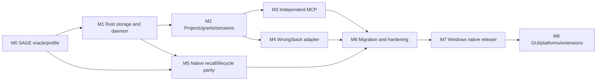

# Delivery backlog, dependencies, and separate-project handoff

Status: proposed. All task IDs below are unimplemented by this planning task.

## 1. Milestone dependency graph

Contracts stabilize before overlapping implementation work. This plan does not request subagents or authorize edits to external tool configuration now. Keep the WrongStack main checkout and its unrelated work intact.

## 2. M0 — Capture SAGE as executable contracts

Outcome: immutable baseline of knowledge semantics and integrations, including less-visible maintenance/sync paths.

| ID | Task | Depends on | Acceptance evidence |
|---|---|---|---|
| WM-000 | Freeze source commit/artifacts and relevant working-tree hashes | None | Clean reproducible baseline; WIP never silently included |
| WM-001 | Export full DDL, helpers, triggers, pragmas, migrations, manifests | WM-000 | Schema fixtures include Unicode helper and HQ projection |
| WM-002 | Export record/candidate/graph/input/feedback/validity types | WM-000 | Versioned JSON fixtures with unknown-field round-trip |
| WM-003 | Inventory all readers/writers/owners and capability consumers | WM-000 | Container, inline recovery, MCP, vector, HQ, WebUI, Companion covered |
| WM-004 | Capture lexical/path/audience/graph/cursor behavior | WM-001..002 | Oracle fixture outputs and ranking/visibility assertions |
| WM-005 | Capture revisions/counters/review/delete/recovery/hygiene | WM-001..002 | Mutation/replay/failure fixtures |
| WM-006 | Capture actual MCP tool/policy and attached/standalone behavior | WM-003 | Generated schema/result inventory; no stale README count |
| WM-007 | Build temporary multilingual/path/worktree/session corpora | WM-004..006 | Positive controls and hard negatives |
| WM-008 | Run/export scoped existing SAGE/MCP/vector/host tests | WM-007 | Actual command/count/status reports; baseline failures disclosed |
| WM-009 | Freeze storage/semantic/host/MCP compatibility profiles | WM-008 | Profile hashes and supported-client floor |
| WM-010 | Baseline latency/resource/quality measures | WM-007 | Reproducible corpora/machine metadata |
| WM-011 | Review code/model/SDK licensing and source extraction | WM-000 | Attribution/distribution strategy |

Exit gate: oracle can regenerate schemas, read results, mutations, and key host behavior from an immutable artifact. No real user store is adopted yet.

## 3. M1 — Standalone repository and safe storage slice

| ID | Task | Depends on | Acceptance evidence |
|---|---|---|---|
| WM-100 | Create separate Cargo/Bun workspace and scoped AGENTS | M0 | Clean checkout builds without WrongStack workspace aliases |
| WM-101 | Refresh registry/toolchain/MSRV/SQLite/SDK features | WM-100 | Stable pinned lockfiles and compatibility notes |
| WM-102 | Contracts crate and generated TS DTO/schema layer | WM-009 | Shared fixtures round-trip, including Unicode/NULL/extensions |
| WM-103 | Read-only store inspector and profile admission | WM-001, WM-102 | Unsupported/newer database bytes unchanged |
| WM-104 | Native fixture storage/codec/FTS/Unicode projections | WM-103 | Oracle parity and corrupt-row/trigger behavior |
| WM-105 | Registry migrations/private data-root/permissions | WM-100 | Isolated roots, interrupted migration recovery |
| WM-106 | Singleton/startup/private IPC/auth/limits | WM-102, WM-105 | Concurrent starts elect one daemon; unauthorized calls denied |
| WM-107 | Owner guard/epoch/transfer journal | WM-003, WM-105 | Competing cooperating writers/stale work rejected |
| WM-108 | Transactional receipts/outbox profile extension | WM-104, WM-107 | Commit-before-reply crash returns original result |
| WM-109 | CLI status/doctor/project fixture read/write slice | WM-106..108 | Real named-pipe request commits and reads a temp record |

Exit gate: native service can safely read/create/update a disposable SAGE-compatible store through real IPC. It cannot yet claim full SAGE behavior.

## 4. M2 — Multi-project identity, grants, sessions, jobs

| ID | Task | Depends on | Acceptance evidence |
|---|---|---|---|
| WM-200 | Register/adopt/managed-store descriptors and collisions | M1 | Existing path preserved; no hidden duplicate authoritative store |
| WM-201 | Canonical project/shared worktree/checkout identity | WM-200 | Shared memory and separate evidence behave correctly |
| WM-202 | Principal/project/action grants and revocation | WM-106, WM-200 | Token/project substitution and revoked-event tests |
| WM-203 | Trusted session binding/resume/release | WM-202 | Caller-supplied session strings cannot cross boundaries |
| WM-204 | Shared visibility policy for read/ID/graph/count/cursor | WM-203 | Complete isolation matrix |
| WM-205 | Per-project writer lanes and fair bounded queues | WM-200 | Many projects without per-project engine processes |
| WM-206 | Durable jobs/schedules/options revision | WM-108, WM-205 | Restart does not lose maintenance intent or weaken policy |
| WM-207 | Scoped event replay/cache invalidation | WM-108, WM-204 | Gaps/revocation/reconnect cannot leak or miss committed change |
| WM-208 | Shutdown/disk-full/root-loss/corruption recovery | WM-205..207 | Original errors and last good knowledge preserved |

Exit gate: three concurrent projects with two clients each preserve isolation and durable jobs through daemon restart. Managed/existing store paths are visible and unambiguous.

## 5. M3 — Independent MCP and external client setup

| ID | Task | Depends on | Acceptance evidence |
|---|---|---|---|
| WM-300 | SDK/protocol-era conformance spike | WM-101 | Exact rmcp/client protocol overlap recorded |
| WM-301 | Native stdio bridge and daemon-independent activation | M2, WM-300 | Works with WrongStack closed; EOF leaves daemon alive |
| WM-302 | SAGE-compatible read tools and bounded results | WM-204, WM-301 | Real MCP call fixtures; hidden IDs/counts remain hidden |
| WM-303 | Read/propose candidates profile | WM-202, WM-302 | Cannot accept/resolve by forged action; attributed proposal persists |
| WM-304 | Opt-in writer/curator field/action grants | WM-303 | Revision/force/idempotency gates enforced by server |
| WM-305 | Managed JSON/TOML client config planner and owned rules | WM-301 | Dry-run/idempotency/concurrent edit/malformed file tests |
| WM-306 | Claude Code/Codex/Cursor/Antigravity presets | WM-305 | Official-doc refresh and installed-client version matrix |
| WM-307 | Generic print/doctor/disconnect and grant cleanup | WM-305 | Unrelated entries and memories preserved |
| WM-308 | Optional loopback HTTP with current/legacy compatibility | WM-300, WM-304 | Origin/auth/cancel/reconnect conformance |
| WM-309 | External agent workflow evaluation | WM-306..307 | Tool discovery vs actual recall/proposal use reported separately |

Exit gate: two independent MCP clients recall/propose to the same project with WrongStack stopped; second project/session data remains inaccessible. HTTP can remain deferred if the release explicitly promises only stdio at this stage.

## 6. M4 — WrongStack connection

| ID | Task | Depends on | Acceptance evidence |
|---|---|---|---|
| WM-400 | WrongMemoryPort capability adapter and typed errors | WM-102, M2 | Existing contract consumers work through IPC |
| WM-401 | Config/factory/container selection | WM-400 | One MemoryStore/MemoryPort; local SQLite not required for native mode |
| WM-402 | Trusted session/workspace/role binding | WM-203, WM-401 | Resume/fork/subagent/WebUI policy tests |
| WM-403 | Preserve setupSage injection/tracker/evidence refresh | WM-402 | Actual tool result/turn render and use-credit parity |
| WM-404 | Capture/remap/domain-term/session-end hooks | WM-403 | Exactly one producer and durable revision-bound effects |
| WM-405 | Vector fusion/mirror ownership and capability negotiation | WM-404 | No double RRF or stale semantic ID leakage |
| WM-406 | WebUI/slash/desktop/Companion/maintenance integration | WM-403..405 | Current management and advisory review behavior |
| WM-407 | MCP connect/ACP forwarding migration | M3, WM-406 | No duplicate SAGE/WrongMemory tool owner; scoped worker grants |
| WM-408 | HQ sync/read/export/apply compatibility | WM-003, WM-400 | Projection/tombstone/conflict parity; not default external MCP |
| WM-409 | Ownership-safe local/auto/failure/rollback | WM-107, WM-401..408 | No timeout-to-inline write fallback |

Exit gate: one supported WrongStack host and one external MCP client share the same accepted knowledge and review queue. Closing either client does not stop the other or create a competing SQLite owner.

## 7. M5 — Full native SAGE behavior

M1 implements only an initial write/read slice. These tasks complete the full profile; a bounded compatibility worker may be used in preview until they pass, but its process/runtime cost must be disclosed.

| ID | Task | Depends on | Acceptance evidence |
|---|---|---|---|
| WM-500 | Exact lexical normalization/FTS/fallback and rank parity | WM-004, WM-104 | Query/filter/order/Unicode/cursor oracle |
| WM-501 | Path/symbol/command/audience/graph retrieval | WM-500 | Node/weight/traversal/hub/visibility parity |
| WM-502 | Remember/update/dedup/relationship semantics | WM-005, WM-104 | Canonical/projection/edge parity, unknown-field retention |
| WM-503 | Counter/feedback/content-recency semantics | WM-502 | No FTS/HQ/embedding churn; revision challenge preserved |
| WM-504 | Candidate/review/merge/resolve/consolidation policies | WM-502..503 | Target/member revision race controls |
| WM-505 | Tombstone/recovery/backfill/purge | WM-504 | No lost knowledge or duplicate active successor |
| WM-506 | Structural verification/validity/checkout evidence | WM-201, WM-501 | Bounded literal checks, unknown vs not-applicable, manual-stale protection |
| WM-507 | Hygiene/schedules/expiry/critical safeguards | WM-206, WM-504..506 | Actual baseline effects and restart cadence |
| WM-508 | Optional service semantic provider interface | WM-500 | Offline lexical readiness; provider failure semantics |
| WM-509 | Semantic mirror/import/cache/fusion profile | WM-405, WM-508 | SAGE authoritative visibility/revision and model partitioning |
| WM-510 | Legacy conversion/JSONL/doctor/corrupt-row compatibility | WM-001, WM-505 | One-time import and non-destructive diagnostics |
| WM-511 | Full native differential profile certification | WM-500..510 | All required surfaces; no hidden legacy worker |

Exit gate: the complete negotiated SAGE profile is implemented. Optional semantic model acceleration may be a later product increment, but existing configured semantic behavior must remain supported through its explicit provider/host boundary; do not silently downgrade enabled capabilities.

## 8. M6 — Migration, security, resilience

| ID | Task | Depends on | Acceptance evidence |
|---|---|---|---|
| WM-600 | Backup/adopt/transfer/release on copied real-shaped stores | M4, M5 | Consistent snapshot, reversible supported owner transition |
| WM-601 | Managed-store vs legacy-location conflict/export | WM-600 | No accidental empty/parallel store or unsafe rollback |
| WM-602 | Crash/retry/cancel fault suite | WM-108, WM-600 | Transaction/receipt/outbox boundary proof |
| WM-603 | Project/session/principal/vector/graph isolation review | M3..M5 | Independent attack cases and fixes with reproducible evidence |
| WM-604 | Multi-project load/soak/WAL/resource tuning | WM-602..603 | Fair scheduling, bounded handles/caches/logs |
| WM-605 | Retrieval-quality corpus and regression budget | WM-010, WM-511 | Held-out applicable facts and hard negatives |
| WM-606 | Native process-tree/capability certification | WM-604..605 | One native memory daemon; bridges disclosed; no Bun engine |

Security review here is future work, not a vulnerability finding from this planning task. Any adversarial-review skill used later retains its applicable no-auto-fix/approval boundary.

## 9. M7 — Windows release and live integration

| ID | Task | Depends on | Acceptance evidence |
|---|---|---|---|
| WM-700 | Per-user headless package/installer and autostart | M6 | Fresh installed runtime without source/Bun/Node |
| WM-701 | Upgrade/drain/registry+store compatibility/rollback | WM-700 | Interrupted update and old binary/data profile handling |
| WM-702 | Uninstall/disconnect/revoke/release ownership | WM-701 | Knowledge and unrelated tool config preserved |
| WM-703 | Operations/privacy/client guides | WM-700..702 | Commands exercised on installed artifacts |
| WM-704 | Exact-commit CI, license assets, checksums/provenance/signing | WM-703 | Artifact/profile identity and honest signing status |
| WM-705 | Downloaded binary + actual WrongStack/MCP demonstration | WM-704 | Full multi-project independent-client acceptance |
| WM-706 | Publish native 1.0 evidence matrix | WM-705 | No required NOT RUN or hidden unsupported behavior |

## 10. M8 — Optional product expansion

| ID | Task | Depends on | Acceptance evidence |
|---|---|---|---|
| WM-800 | Desktop/tray project and review management | M7 | Real service state; GUI close never stops daemon |
| WM-801 | Additional installed client presets/hooks | M3, M7 | Versioned official docs and actual client smoke |
| WM-802 | Linux/macOS endpoints/watch/user-service packaging | M7 | Native platform suites and downloaded artifact proof |
| WM-803 | Explicit global preference namespace | M7 | Consent/promotion/filter/backup boundary and isolation tests |
| WM-804 | WrongIndex event/anchor adapter | M6, supported WrongIndex | No duplicate remap producer; checkout-bound evidence |
| WM-805 | Native local embedding runtime/model acceleration | WM-508..509 | Version/license/tokenizer/output/resource/quality proof |

## 11. Effort assumptions

One experienced engineer, full-time, with review access and a cooperative WrongStack integration release. These are planning ranges, not commitments:

| Workstream | Engineering effort |
|---|---|
| M0 contract/oracle | 1–2 weeks |
| M1 storage/IPC | 1.5–3 weeks |
| M2 multi-project/policy/sessions | 1–2 weeks |
| M3 MCP and first client presets | 1.5–3 weeks |
| M4 WrongStack integration | 2–4 weeks |
| M5 full native semantics | 3–6+ weeks |
| M6 hardening/quality/soak | 2–4 weeks |
| M7 packaging/release | 1–2 weeks |

A useful partial preview is plausibly 5–9 elapsed weeks with deliberate scope labeling. Full native SAGE-compatible acceptance is approximately 13–26+ engineering weeks depending on existing contract debt and policy/host interactions. Optional GUI, additional platforms, native inference, and global sharing are extra. Re-estimate after M0 and the MCP protocol spike rather than lowering required parity.

## 12. First ten implementation sessions

1. Refresh source research, capture clean hashes/fixtures, and confirm the full writer/consumer inventory.
2. Export SAGE/HQ/Unicode/FTS schema plus record/candidate mutation oracle.
3. Freeze retrieval/isolation/host/MCP profile and collect baseline performance.
4. Create the separate repository with current toolchain/SDK preflight and lockfiles.
5. Implement native codec/store inspector and disposable storage/FTS slice.
6. Implement private singleton/IPC/auth and registry migrations.
7. Implement ownership, transactional receipts, and crash-before-reply proof.
8. Implement project grants/workspace/session binding across three fixtures.
9. Implement stdio bridge with read/propose policy; prove it works without WrongStack.
10. Add first WrongMemoryPort adapter slice and demonstrate one accepted candidate shared across native host and external client.

Sessions are sequencing units, not guaranteed one-day tasks. Report task IDs, actual validation, unresolved contracts, and next exit gate at each checkpoint.

## 13. Separate-project kickoff instruction

> Start WrongMemory in the explicitly selected separate directory. Read the complete WrongMemory plan first. Preserve the WrongStack main checkout and all unrelated WIP, including WrongIndex planning. Begin with M0 and the smallest M1 native IPC/storage slice on disposable fixture stores. Refresh toolchain/SDK/model registries before installation. Preserve SAGE JSON/SQL/graph/validity/review/session semantics, all capability consumers, and worktree identity. External MCP must work with WrongStack closed. Implement server-side project/action/session grants; never rely on model arguments or client confirmation alone. Do not adopt live user memory, edit external tool configurations, install autostart, or publish as part of bootstrap unless requested. Distinguish hybrid preview from native completion and report exact evidence.

Copy this plan and rewrite relative source links against the captured WrongStack artifact/reference checkout. The independent repository must not build by importing an uncommitted absolute local WrongStack path.
